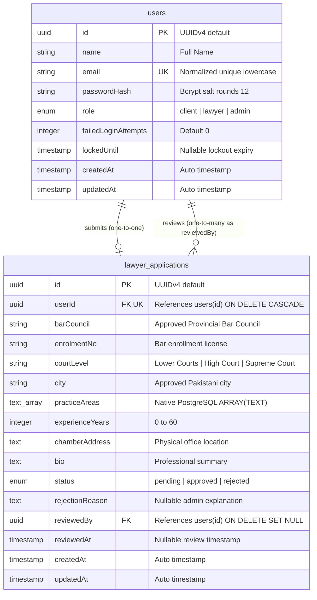

# LegalHub - Database Architecture & Design

This document details the PostgreSQL relational database schema for LegalHub, hosted on Supabase and managed using Sequelize ORM migrations.

---

## 1. Visual Entity-Relationship (ER) Diagram

---

## 2. Table Specifications

### 2.1 `users` Table
Stores authentication credentials, system roles, and account security tracking.

| Column | Type | Nullable | Default | Constraints & Description |
| :--- | :--- | :--- | :--- | :--- |
| `id` | `UUID` | No | `UUIDV4` | **Primary Key** |
| `name` | `VARCHAR(255)` | No | None | User's full name |
| `email` | `VARCHAR(255)` | No | None | **Unique**, stored strictly in lowercase |
| `passwordHash` | `VARCHAR(255)` | No | None | Bcrypt hash (12 salt rounds, never exposed) |
| `role` | `ENUM` | No | `'client'` | Allowed values: `'client'`, `'lawyer'`, `'admin'` |
| `failedLoginAttempts` | `INTEGER` | No | `0` | Incremented on bad password; reset on success |
| `lockedUntil` | `TIMESTAMP` | Yes | `NULL` | Future timestamp until which logins are blocked |
| `createdAt` | `TIMESTAMP` | No | Current time | Standard Sequelize creation audit |
| `updatedAt` | `TIMESTAMP` | No | Current time | Standard Sequelize update audit |

---

### 2.2 `lawyer_applications` Table
Stores advocate onboarding submissions, Bar Council credentials, and administrative review states.

| Column | Type | Nullable | Default | Constraints & Description |
| :--- | :--- | :--- | :--- | :--- |
| `id` | `UUID` | No | `UUIDV4` | **Primary Key** |
| `userId` | `UUID` | No | None | **Foreign Key** $\rightarrow$ `users(id)`, **Unique** (1-to-1) |
| `barCouncil` | `VARCHAR(255)` | No | None | Approved Bar Council string |
| `enrolmentNo` | `VARCHAR(255)` | No | None | License number |
| `courtLevel` | `VARCHAR(255)` | No | None | Approved court qualification level |
| `city` | `VARCHAR(255)` | No | None | Approved Pakistani city of practice |
| `practiceAreas` | `TEXT[]` | No | `ARRAY[]` | Native PostgreSQL string array (1 to 5 items) |
| `experienceYears` | `INTEGER` | No | None | Valid range: 0 to 60 |
| `chamberAddress` | `TEXT` | No | None | Office location (confidential, never public) |
| `bio` | `TEXT` | Yes | `NULL` | Public summary of advocate practice |
| `status` | `ENUM` | No | `'pending'` | Allowed: `'pending'`, `'approved'`, `'rejected'` |
| `rejectionReason` | `TEXT` | Yes | `NULL` | Mandatory min 10 chars if status is rejected |
| `reviewedBy` | `UUID` | Yes | `NULL` | **Foreign Key** $\rightarrow$ `users(id)` of reviewing Admin |
| `reviewedAt` | `TIMESTAMP` | Yes | `NULL` | Timestamp when status changed to approved/rejected |
| `createdAt` | `TIMESTAMP` | No | Current time | Submission timestamp |
| `updatedAt` | `TIMESTAMP` | No | Current time | Modification timestamp |

---

## 3. Database Indexes & Constraints

| Index Name | Table | Columns | Type | Purpose |
| :--- | :--- | :--- | :--- | :--- |
| `users_email_unique_idx` | `users` | `email` | Unique B-Tree | High-speed login lookup & prevents duplicate emails |
| `lawyer_applications_bar_enrolment_unique` | `lawyer_applications` | `(barCouncil, enrolmentNo)` | Composite Unique | **Anti-fraud**: Prevents multiple lawyers from using the same Bar Council license |
| `lawyer_applications_status_idx` | `lawyer_applications` | `status` | B-Tree | Fast filtering for public directory (approved lawyers only) |

---

## 4. Architectural Highlights

1. **Composite Unique Index on Bar Council & License:**
   In Pakistan, provincial Bar Councils (Punjab, Sindh, etc.) issue licenses independently. An enrolment number is unique within its respective Bar Council. By enforcing a composite unique constraint on `(barCouncil, enrolmentNo)`, the database prevents license theft.
2. **PostgreSQL Native Array (`TEXT[]`) vs Many-to-Many Tables:**
   Advocates choose between 1 to 5 practice areas. In legacy SQL databases, this requires three tables (`lawyers`, `practice_areas`, and a join table `lawyer_practice_areas`). PostgreSQL native arrays allow compact, high-performance in-row storage with full indexable containment queries (`[Op.contains]`), eliminating complex multi-table joins.
3. **Audited State Transitions:**
   Whenever an application transitions from `pending` to `approved` or `rejected`, the database captures who authorized it (`reviewedBy`) and when (`reviewedAt`), ensuring full compliance accountability.
