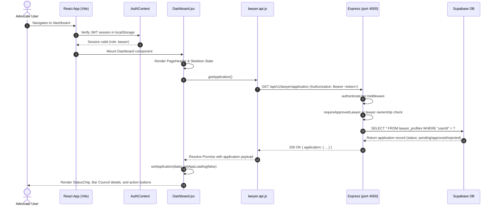

# Frontend Part 0: Dashboard Shell & UI Primitives (FE-0)

Welcome to **Frontend Part 0** of the LegalHub FYP learning series. This guide documents the foundational user interface architecture, reusable design system primitives, and responsive layout shell powering the LegalHub client application.

---

## 1. Pakistani Real-Life Analogies

To understand the architecture of our dashboard shell and UI primitives, consider how physical legal institutions in Pakistan operate:

### A. The Registrar's Portico & Identification Badges (The Dashboard Shell & StatusChip)
When entering the Lahore High Court or the Multan District Courts (*Kachehri*), litigating citizens and legal practitioners do not wander through random corridors.
1. **The Central Portico (Dashboard Shell):** The entrance features clear departmental signs directing visitors to the Civil Branch, Criminal Branch, Stamp Vendors, and Judicial Registrar. This corresponds to our **`DashboardLayout`** sidebar and topbar, showing dedicated pathways based on whether you are a Client, Advocate, or Court Administrator.
2. **Identification Ribbons & Badges (`StatusChip`):** Advocates wear black robes (*Gown*) with white neckbands; court clerks wear government service tags; litigants carry court summons. Similarly, every user in LegalHub is visually identified by a token-styled `StatusChip` reflecting their role (`advocate`, `client`, `admin`) and licensing verification state (`pending`, `approved`, `rejected`), strictly adhering to Rule 135 without sensationalist titles like "Top Attorney".

### B. The Solemn Oath / Dastakhat (ConfirmDialog Modal)
In Pakistani legal proceedings, a petition or withdrawal is never executed casually by a single accidental remark. The court reader (*Munshi* or *Reader Sahib*) asks: *"Are you certain you wish to sign and withdraw this vakalatnama?"*
Similarly, destructive actions on LegalHub—such as signing out of a secure session or rejecting an advocate's Bar Council credentials—trigger an accessible, keyboard-trapped **`ConfirmDialog`** modal requiring explicit confirmation.

### C. The Court Peon's Verbal Announcement / Munshi's Slip (Toast System)
When a case file is submitted or a decree certified, the court clerk hands you a receipt slip or calls out the case title. Our non-intrusive **`ToastProvider`** serves this exact function: transient, polite notices that slide into view to confirm actions (e.g. *"Licensing application updated"*) without freezing the user interface.

---

## 2. Architecture & File Catalog

All UI components adhere strictly to the project's **8px spacing grid** and design token system defined in `frontend/src/styles/tokens.css`. No ad-hoc colors or unvetted CSS libraries are used.

| Component / File | File Path | Primary Responsibility |
| :--- | :--- | :--- |
| **`StatusChip`** | `frontend/src/components/StatusChip.jsx` | Accessible badge rendering standardized colors and labels for roles, application statuses, booking states, and engagements. |
| **`EmptyState`** | `frontend/src/components/EmptyState.jsx` | Clear callout for zero-data states featuring an icon, title, explanatory text, and primary call-to-action button. |
| **`PageHeader`** | `frontend/src/components/PageHeader.jsx` | Standardized page header with title, subtitle, optional status badge, breadcrumbs, and contextual action buttons. |
| **`ConfirmDialog`** | `frontend/src/components/ConfirmDialog.jsx` | Accessible modal dialog with backdrop blur, escape-key listener, body scroll lock, and explicit confirm/cancel handlers. |
| **`ToastContext` & `Toast`** | `frontend/src/context/ToastContext.jsx` | React context and hook (`useToast`) providing global transient alert popups (`success`, `error`, `warning`, `info`). |
| **`DashboardLayout`** | `frontend/src/components/DashboardLayout.jsx` | Responsive app shell: 240px fixed sidebar on desktop, off-canvas slide-out drawer on mobile (<768px), sticky topbar with user capsule and sign-out confirmation. |
| **`Dashboard`** | `frontend/src/pages/Dashboard.jsx` | Unified dashboard consuming live runtime API endpoints (`GET /api/v1/lawyer/application`), displaying genuine user data and zero synthetic mock widgets. |
| **`client.js`** | `frontend/src/api/client.js` | Axios HTTP client configured with bearer token injection and resilient error envelope normalization. |

---

## 3. Real Data Principle (Elimination of Fake Widgets)

In academic FYPs, students frequently populate dashboards with synthetic counters (e.g., *"1,250 Cases Won"*, *"99% Satisfaction"*). Under our non-negotiable **Academic Honesty** and **Regulatory Compliance** rules:
1. **Zero Synthetic Counters:** The dashboard contains no hardcoded or fabricated statistics.
2. **Dynamic Advocate State:**
   - If an advocate has not submitted Bar Council credentials, `Dashboard.jsx` renders an accessible **`EmptyState`** prompting them to apply.
   - If submitted and pending review, a yellow status card displays the submitted provincial Bar Council and enrolment details under administrative review.
   - If rejected, an alert displays the administrator's specific rejection remarks so the advocate can correct their application.
   - If approved, an active status chip confirms their public directory listing.
3. **Purge of `law_firm`:** All leftover references to the `law_firm` role were purged from constants, navigation links, and badges to ensure an uncluttered MVP focused on verified individual advocates.

---

## 4. End-to-End Action Trace: Advocate Dashboard Load

The following diagram illustrates the complete runtime sequence when an advocate accesses `/dashboard`:



---

## 5. Hands-on FYP Exercises for Students

### Exercise 1: Mobile Responsive Drawer Verification
1. Open the LegalHub frontend in Chrome or Edge (`http://localhost:3000`).
2. Press `F12` to open Developer Tools and toggle the Device Toolbar (`Ctrl + Shift + M`).
3. Set the viewport width to **375px** (simulating an iPhone or standard Android device).
4. Verify that:
   - The desktop 240px sidebar disappears and the hamburger icon (`☰`) appears in the topbar.
   - Clicking the hamburger smoothly slides the drawer in from the left and displays a semi-transparent dark backdrop.
   - Clicking the backdrop or navigating to any link closes the drawer automatically.

### Exercise 2: Triggering Global Toasts via `useToast()`
1. In `frontend/src/pages/Dashboard.jsx`, import the `useToast` hook:
   ```jsx
   import { useToast } from '../context/ToastContext';
   ```
2. Inside the component, instantiate `const { showToast } = useToast();`.
3. Add a temporary button inside the header actions:
   ```jsx
   <button
     type="button"
     className="btn btn-secondary btn-sm"
     onClick={() => showToast('Testing global toast system!', 'success')}
   >
     Test Toast
   </button>
   ```
4. Click the button and observe the green checkmark toast slide into the bottom-right corner and automatically auto-dismiss after 4 seconds.

### Exercise 3: Inspect Error Normalization in `client.js`
1. Open the browser Network tab.
2. Sign in with invalid credentials at `http://localhost:3000/login`.
3. Observe the response from Express (`401 Unauthorized` with `{ "error": "Invalid email or password" }`).
4. Notice how the Axios response interceptor in `client.js` catches the string `error.response.data.error` and forwards it cleanly to the UI alert, avoiding ugly raw `[object Object]` crashes.

---

## 6. Viva Defense Questions & Answers

### Q1: Why did you build custom Vanilla CSS components instead of using Tailwind CSS or Material UI?
> **Answer:** In compliance with our final-year project technical guidelines, Vanilla CSS combined with centralized CSS variables (`tokens.css`) provides complete control over our design system, eliminates bloated runtime dependencies, and guarantees strict adherence to our 8px spacing scale. It demonstrates fundamental mastery of responsive web layout principles (flexbox, grid, and CSS media queries) without relying on heavy third-party CSS abstractions.

### Q2: How does the dashboard shell enforce Rule 135 of the Legal Practitioners and Bar Councils Rules 1976?
> **Answer:** Rule 135 strictly prohibits Pakistani advocates from commercial solicitation and promotional advertising. Our dashboard shell enforces this by:
> 1. Eliminating promotional rankings, sponsored cards, or vanity badges like "Top Advocate" or "Premier Law Firm".
> 2. Using objective, regulatory-aligned status chips: **"Admin-Reviewed Advocate"**, **"Under Admin Review"**, or **"Action Required"**.
> 3. Displaying factual licensing attributes: Provincial Bar Council, official enrolment number, court level, and primary city.

### Q3: Why does `DashboardLayout` lock the body scroll when the mobile drawer is opened?
> **Answer:** When an off-canvas drawer is open on mobile devices, user touch scrolls can cause the underlying page content to scroll unexpectedly (known as "scroll chaining" or "background bleed"). By setting `document.body.style.overflow = 'hidden'` in an effect hook while `isMobileMenuOpen` is true, we prevent accidental background scrolling and ensure an intuitive native-app experience.

### Q4: How is modal accessibility handled in `ConfirmDialog.jsx`?
> **Answer:** `ConfirmDialog` adheres to WAI-ARIA modal guidelines:
> 1. It utilizes `role="dialog"` and `aria-modal="true"`.
> 2. It connects its title and description using `aria-labelledby` and `aria-describedby`.
> 3. It attaches a keyboard listener to automatically dismiss the modal when the `Escape` key is pressed.
> 4. When the user confirms or cancels, focus is returned to the triggering button.

### Q5: How does the frontend handle missing advocate application records gracefully?
> **Answer:** When a newly registered lawyer logs in, their profile record does not yet exist in the `lawyer_profiles` table, causing the backend endpoint `GET /api/v1/lawyer/application` to return a `404 Not Found`. Instead of treating this as a fatal server crash, the dashboard catches the 404 status specifically and sets `application` to `null`. This conditionally triggers the `EmptyState` primitive, welcoming the advocate and presenting a direct button to submit their Bar Council credentials.
