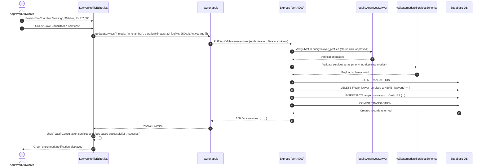

# Frontend Part 1: Advocate Profile, Bar Council Licensing & Services (FE-1)

Welcome to **Frontend Part 1** of the LegalHub FYP learning series. This guide documents the design, architecture, and implementation of the advocate profile management interface, consultation fee structure, weekly chamber hours, and court vacation management.

---

## 1. Pakistani Real-Life Analogies

To understand the workflow of Part FE-1, consider how practicing Pakistani advocates operate their chambers:

### A. The Chamber Nameplate & Fee Schedule (Chamber Profile & Services)
When visiting an advocate's chamber at the Lahore High Court Bench or Multan District Courts (*Kachehri*):
1. **The Official Chamber Nameplate:** Outside the door, a brass or acrylic plaque lists the advocate's verified credentials:
   - *Advocate High Court*
   - *Enrolment No. P-14285 (Punjab Bar Council)*
   - *Specialization: Civil, Constitutional & Family Law*
   In LegalHub, this is represented by **`LawyerProfileEditor`**, where advocates document their professional headline, spoken languages (Urdu, English, Punjabi, Sindhi, Pashto, Saraiki), and factual legal background.
2. **The Munshi's Consultation Fee Schedule:** Inside the chamber, the clerk (*Munshi*) informs clients of standard initial consultation rates depending on the mode of engagement:
   - *In-Chamber Conference:* PKR 3,000 for 30 minutes
   - *Audio Call Consultation:* PKR 1,500 for 30 minutes
   - *Video Conference:* PKR 2,000 for 30 minutes
   Under **Rule 135**, fees must be stated transparently without promotional puffery or misleading discount banners.

### B. The Court Vacation Roster & Gazette Holidays (Chamber Hours & Blocked Dates)
Pakistani superior and subordinate courts strictly observe judicial calendars:
1. **Regular Chamber Hours:** Advocates attend court hearings in the morning (08:30 AM – 01:30 PM) and hold client consultations in their chambers during late afternoon/evening hours (04:00 PM – 08:00 PM).
2. **Judicial Recess & Circuit Benches (Blocked Dates):** During High Court summer vacations (August) or when an advocate travels for Supreme Court registry hearings in Islamabad, the chamber is closed. Our **Blocked Dates** module allows practitioners to mark these dates on their calendar, preventing clients from booking unavailable slots.

---

## 2. Architecture & File Catalog

| Component / File | File Path | Primary Responsibility |
| :--- | :--- | :--- |
| **`LawyerProfileEditor`** | `frontend/src/pages/LawyerProfileEditor.jsx` | Full tabbed profile management portal: bio & languages, services & fees, weekly chamber schedule, and blocked calendar dates. |
| **`LawyerProfileEditor.css`** | `frontend/src/pages/LawyerProfileEditor.css` | Token-compliant stylesheet for tabbed navigation, service cards, weekday schedule windows, and responsive mobile layout. |
| **`lawyerApi`** | `frontend/src/api/lawyer.api.js` | Complete API client methods interfacing with `/api/v1/lawyer/profile`, `/services`, `/availability`, and `/blocked-dates`. |
| **`constants/index.js`** | `frontend/src/constants/index.js` | Centralized constants for `LANGUAGES`, `SERVICE_MODES`, `SERVICE_MODE_LABELS`, `SLOT_DURATIONS`, and `WEEKDAYS`. |
| **`DashboardLayout`** | `frontend/src/components/DashboardLayout.jsx` | Integrated navigation link (`💼 Chamber Profile & Fees`) for authenticated advocates. |
| **`Dashboard`** | `frontend/src/pages/Dashboard.jsx` | Dynamic quick-action button redirecting approved advocates directly to profile configuration. |

---

## 3. Security & Rule 135 Regulatory Gates

1. **Scrutiny Pre-condition (`requireApprovedLawyer`):**
   - In physical courts, an intern or unverified applicant cannot hang an advocate plaque outside a chamber.
   - On LegalHub, if an advocate's Bar Council application is `pending`, `rejected`, or absent, the `LawyerProfileEditor` prevents configuration access and displays an accessible `EmptyState` directing them to the Bar Council verification portal.
2. **Prohibition of Commercial Solicitation (Rule 135):**
   - No discounts, strikethrough prices, or "limited time offers".
   - Fees are integers in Pakistani Rupees (`feePkr`, between 0 and 200,000).
   - Maximum of 4 consultation services per advocate (strictly 1 service per mode: `chat`, `phone`, `video`, `in_chamber`).
3. **Availability Time Window Validation:**
   - Maximum 3 non-overlapping windows per weekday.
   - `startTime` must be strictly before `endTime` (e.g., 09:00 to 13:00).
   - Blocked dates cannot be in the past and use the `Asia/Karachi` timezone standard.

---

## 4. End-to-End Action Trace: Updating Consultation Services

---

## 5. Hands-on FYP Exercises for Students

### Exercise 1: Verify the Bar Council Scrutiny Guard
1. Register a new advocate account at `http://localhost:3000/register`.
2. Do not submit or approve their Bar Council application.
3. In the sidebar, navigate to **Chamber Profile & Fees** (`http://localhost:3000/lawyer/profile`).
4. Verify that the editor displays the `EmptyState` card with the title:
   *"Bar Council Verification Required"* and a button linking to `/lawyer/application`.

### Exercise 2: Configure Distinct Consultation Modes
1. Login as an approved advocate.
2. Navigate to **Chamber Profile & Fees** and switch to the **Consultation Services** tab.
3. Configure two services:
   - Service 1: `In-Chamber Meeting`, 30 Mins, PKR 3,000.
   - Service 2: `Video Conference`, 45 Mins, PKR 2,500.
4. Click **Save Consultation Services** and observe the green toast notification.
5. Attempt to add a second `In-Chamber Meeting` and verify that the duplicate-mode safeguard prevents duplicate service entries.

### Exercise 3: Block and Unblock a Court Vacation Date
1. Switch to the **Blocked Dates & Vacation** tab.
2. Select a date two weeks in the future (e.g. during High Court summer recess).
3. Enter the reason: *"High Court Summer Vacation - Chamber Closed"*.
4. Click **+ Block Selected Date**. Verify that the date appears immediately in the table.
5. Click **Unblock**. Confirm that the `ConfirmDialog` modal opens asking for explicit confirmation.
6. Click **Unblock Date** and verify that the date is removed from the table.

---

## 6. Viva Defense Questions & Answers

### Q1: Why are consultation services atomically replaced (`DELETE` + `INSERT` in a transaction) instead of individually patched?
> **Answer:** Atomicity and consistency. An advocate offers a coherent set of up to 4 consultation modes with specific durations and pricing. When an advocate updates their service offerings, doing an atomic replacement inside a single database transaction guarantees that clients never see a half-updated or corrupt list of services if a network glitch occurs mid-request.

### Q2: How does the profile editor prevent violations of Bar Council Rule 135?
> **Answer:** Rule 135 prohibits self-laudatory claims and commercial advertising. The profile editor strictly controls the input schema:
> 1. It enforces character limits on headlines (120 characters) and biographies (2,000 characters).
> 2. It restricts languages to an approved list of regional and national languages.
> 3. It enforces integer consultation fees in PKR without allowing discount badges or marketing slogans.

### Q3: Why is there an access guard on `/lawyer/profile` before Bar Council approval?
> **Answer:** In Pakistani law, practicing law or holding oneself out as an advocate without verified enrolment with a provincial Bar Council is an offense under the Legal Practitioners and Bar Councils Act 1973. Enforcing this guard ensures that unverified or rejected individuals cannot publish fees or accept legal appointments on the platform.

### Q4: How are availability rules validated to ensure clients can actually book appointments?
> **Answer:** The schema validates that `startTime < endTime` for every window and limits each day to 3 non-overlapping windows. When combined with the advocate's configured `slotMinutes` (15, 30, 45, or 60), the slot generator slices each window into precise, bookable appointment slots.

### Q5: Why is date validation anchored to the `Asia/Karachi` timezone?
> **Answer:** In cross-timezone web applications, dates like `2026-10-21` can shift to `2026-10-20` or `2026-10-22` depending on whether the server or client uses UTC. Because Pakistani courts and chambers operate strictly in Pakistan Standard Time (PKT, UTC+5), all calendar date parsing and past-date validations are explicitly normalized to `Asia/Karachi`.
