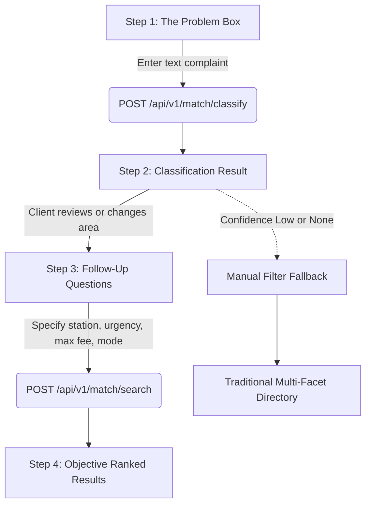
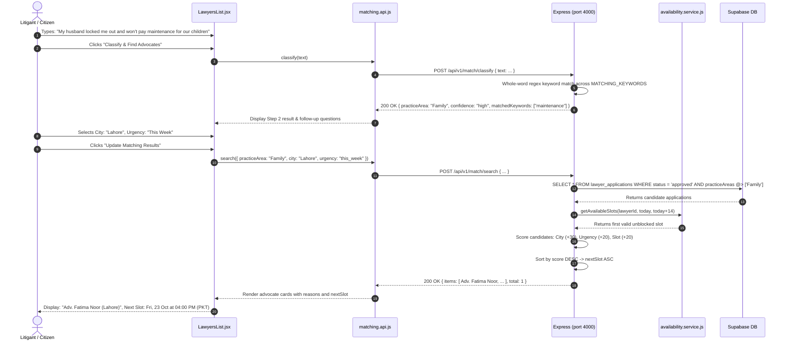

# Frontend Part 2: Intelligent Issue Matching & Advocate Directory (FE-2)

Welcome to **Frontend Part 2** of the LegalHub FYP learning series. This guide documents the design, architecture, and regulatory safeguards powering our intelligent legal grievance matching assistant, multi-facet advocate directory, and public chamber profile views.

---

## 1. Pakistani Real-Life Analogies

To understand how Part FE-2 bridges the gap between everyday citizens and formal legal representation, consider how physical courts in Pakistan handle incoming litigants:

### A. The District Court Inquiry Munshi (The Problem Box & Classifier)
When a common citizen (*Sael*) arrives at the Multan District Courts (*Kachehri*) or the Lahore High Court Registry, they do not speak in statutory code sections. They speak in terms of daily distress:
- *"My landlord locked my grain shop overnight and won't let me retrieve my stock."* (Rent Restriction & Property Law)
- *"My husband turned me out of the house and refuses to provide maintenance (*Nan-o-Nafqa*) for our two minor daughters."* (Family Court Act & Guardianship)
- *"A local sub-inspector is threatening to register a bogus FIR over a commercial payment dispute."* (Criminal Procedure Code & Pre-Arrest Bail)

In traditional courts, an experienced court reader or Bar Association Munshi listens, extracts statutory keywords (*Khula*, *Maintenance*, *Injunction*, *Eviction*), and maps the matter to the correct branch. Our **`matchingApi.classify`** engine performs this exact task deterministically:
1. It analyzes the complaint text for legal terms.
2. It assigns a confidence rating (`high`, `low`, `none`).
3. It allows the citizen to freely change or confirm the practice area if they prefer a different category.

### B. The Registrar's Chamber Roster (Objective Ranked Recommendations)
Under **Rule 135 of the Legal Practitioners and Bar Councils Rules 1976**, Pakistani advocates are strictly prohibited from commercial advertising, paying for top search placements, or claiming to be the "Best" or "Top" lawyer.
To respect both the law and the citizen's urgent need:
1. The inquiry desk does not recommend advocates because of paid sponsorship.
2. Instead, it suggests verified practitioners based on **objective factual alignment**:
   - *Does the advocate practice in this field?* (Required baseline)
   - *Is their chamber at the station where the case is filed?* (City alignment: +30 points)
   - *Do they speak the litigant's native language?* (Language alignment: +10 points)
   - *Do they have an open calendar consultation slot within the citizen's urgency timeframe?* (Availability: +40 points)
3. Every recommendation is accompanied by transparent, plain-English reasons (e.g., *"Practises Family law"*, *"Based in Multan"*, *"Next slot available today at 4:00 PM"*).

---

## 2. Architecture & File Catalog

| Component / Layer | File Path | Primary Responsibility |
| :--- | :--- | :--- |
| **`matchingApi`** | `frontend/src/api/matching.api.js` | Client for `POST /api/v1/match/classify` (deterministic issue analysis) and `POST /api/v1/match/search` (multi-factor candidate ranking). |
| **`directoryApi`** | `frontend/src/api/directory.api.js` | Client for `GET /api/v1/lawyers` (directory search), `GET /api/v1/lawyers/:id` (detail), `:id/slots` (calendar slots), and `:id/reviews` (public reviews). |
| **`LawyersList`** | `frontend/src/pages/LawyersList.jsx` | Dual-mode interface: Intelligent Issue Matcher (Steps 1–4) and Manual Multi-Facet Directory Browse with Rule 135 sorting. |
| **`LawyersList.css`** | `frontend/src/pages/LawyersList.css` | Token-compliant stylesheet for problem box, confidence badges, follow-up grids, and advocate cards. |
| **`LawyerProfile`** | `frontend/src/pages/LawyerProfile.jsx` | Public advocate chamber view: verified credentials, fee structure, upcoming 14-day calendar slots, and verified client reviews. |
| **`seed_marketplace.js`** | `backend/scripts/seed_marketplace.js` | Comprehensive database seeder providing approved advocates across Lahore, Multan, Karachi, Islamabad, Peshawar, Rawalpindi, and Quetta. |

---

## 3. The 4-Step Intelligent Matching Workflow

1. **Step 1: The Problem Box:** The user inputs their complaint or clicks one of the realistic Pakistani test prompts. Minimum 10 characters, maximum 1,000 characters.
2. **Step 2: Classification Result:** Displays detected practice area with a confidence badge (`high`, `low`, or `none`) and matched statutory terms. The user can override the category at any time with a single click.
3. **Step 3: Follow-up Questions:** Refines matching by selecting station/city, urgency level (`today`, `this_week`, `flexible`), consultation mode, max fee budget (PKR), and spoken language.
4. **Step 4: Objective Ranked Results:** Renders candidate cards showing:
   - Name and verified court jurisdiction (`Advocate High Court`, etc.).
   - Transparent objective reasons (`✓ Practises Family law`, `✓ Based in Lahore`, `✓ Upcoming consultation slots available`).
   - Highlighted next available slot timestamp formatted in Pakistan Standard Time (`Asia/Karachi`).
   - Starting consultation fee in PKR.
5. **Deterministic Sorting Rule:**
   $$\text{Rank} = \text{Score DESC} \longrightarrow \text{Earliest Next Slot ASC} \longrightarrow \text{ID ASC}$$

---

## 4. End-to-End Action Trace: Citizen Matching Flow

---

## 5. Hands-on FYP Exercises for Students

### Exercise 1: Test Keyword Determinism
1. In the Issue Matcher problem box, enter: *"Police threatened a fake FIR and I need pre-arrest bail."*
2. Verify that the system detects `Criminal` law with `High Confidence Match` and identifies `bail` and `fir` as matched statutory terms.
3. Replace the text with: *"Land boundary dispute with patwari mutation error."*
4. Verify that the category shifts to `Property` with keywords `mutation` and `boundary`.

### Exercise 2: Category Override & City Scoring
1. Enter a vague legal sentence: *"Someone broke an agreement with my company."*
2. Observe the classification output.
3. Click the **Civil** or **Corporate** pill to override the detected area.
4. Set the city selector to **Multan**. Notice how **Adv. Tariq Mehmood** receives the `Based in Multan` score bonus (+30 points) and moves to the top of the ranked results.

### Exercise 3: Manual Filter Fallback & Rule 135 Sorting
1. Click the **Browse All Advocates** tab.
2. Select **Sort Order: Experience (Years at Bar)**. Verify that senior advocates (e.g. Adv. Zulfiqar Ali Bhutto Jr., 18 years) appear first.
3. Change sort order to **Fee: Lowest to Highest**. Verify that advocates offering services from PKR 1,200 appear at the top.
4. Verify that no sponsored or promoted ribbons exist anywhere on the cards.

---

## 6. Viva Defense Questions & Answers

### Q1: How does your matching engine prevent violations of Rule 135 of the Legal Practitioners and Bar Councils Rules 1976?
> **Answer:** Rule 135 prohibits Pakistani advocates from advertising or soliciting business commercially. Our system strictly complies by:
> 1. Eliminating paid priority sorting, sponsored tags, and vanity ribbons like "Top Attorney".
> 2. Ordering results purely by deterministic, verifiable factors: legal speciality match, geographical proximity to the court station, language fluency, and available appointment slots.
> 3. Displaying plain, factual reasons explaining why each candidate appeared (e.g., *"Practises Family law"*, *"Based in Lahore"*).

### Q2: Why did you implement deterministic keyword matching instead of sending user grievances to an external LLM API?
> **Answer:** 
> 1. **Data Confidentiality & Privilege:** Sending sensitive citizen legal grievances to third-party cloud LLMs risks leaking confidential legal information.
> 2. **Determinism and Reproducibility:** A keyword-based classifier produces predictable, verifiable results that can be audited by court administrators.
> 3. **Performance & Reliability:** The deterministic regex classifier executes in under 2 milliseconds without network latency, token costs, or rate limits.

### Q3: How is tie-breaking handled when two advocates have identical match scores?
> **Answer:** When scores are identical, ties are broken by calendar urgency: the candidate with the earliest upcoming available slot (`nextSlot ASC`) appears first. If both have identical slots, a deterministic UUID comparison (`id ASC`) ensures stable pagination without jitter.

### Q4: Why is there an explicit "Manual Filters Fallback"?
> **Answer:** Not all legal disputes fit cleanly into automated keyword dictionaries (e.g. cross-border maritime issues or novel cyber litigation). When the classifier confidence is `none` or `low`, forcing an automated guess would frustrate the litigant. Providing an immediate fallback to traditional multi-facet filters guarantees that citizens always have full autonomous control over their search.

### Q5: Why is the client rating average displayed only when `ratingAvg` is not null?
> **Answer:** Displaying a `0.0` or placeholder rating for newly enrolled advocates who have not yet concluded a booked consultation would unfairly prejudice their reputation. Under academic honesty and regulatory fairness standards, rating averages are rendered only once genuine, verified client reviews have been recorded in the database.
