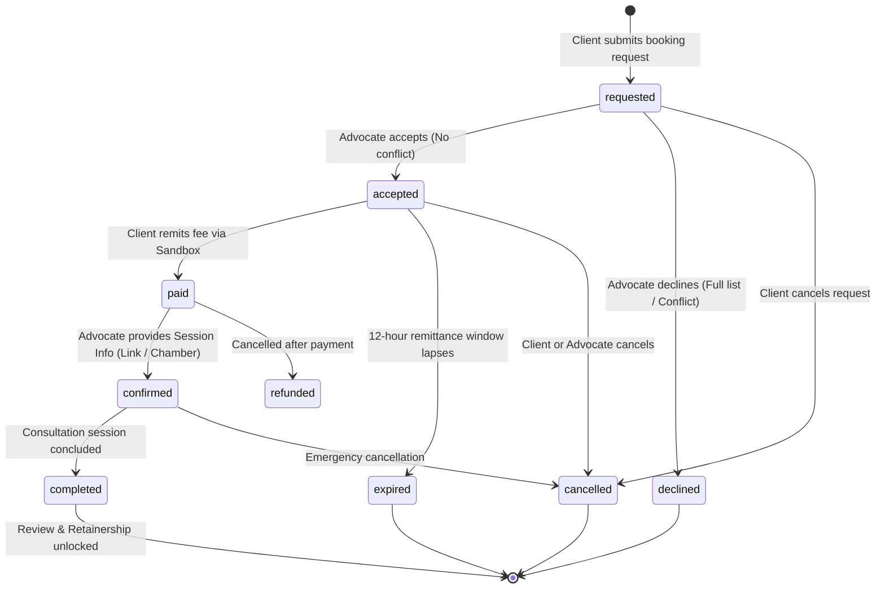

# Frontend Part 3: Consultation Booking Lifecycle, Slot Reservations & Advocate Roster (FE-3)

Welcome to **Frontend Part 3** of the LegalHub FYP learning series. This guide documents the design, architecture, and regulatory safeguards powering our real-time consultation booking workflow, calendar slot reservation engine, sandbox fee settlement, and advocate appointment roster.

---

## 1. Pakistani Real-Life Analogies

To understand the legal, procedural, and cultural rationale behind the consultation lifecycle, consider how physical courts and legal chambers operate across Pakistan:

### A. The Bar Association Chamber Diary (*Wakt & Peshi*)
When a litigant arrives at an advocate's chamber near the District Courts (*Kachehri*) or High Court Bar Association, they cannot simply walk into an ongoing confidential conference. 
1. The advocate's clerk (*Munshi*) checks the daily appointment diary (*Roznamcha*).
2. The Munshi verifies that the advocate is not currently standing before a division bench or recording cross-examination in the trial court.
3. Our **`availabilityApi.getAvailableSlots`** and **`BookConsultation.jsx`** perform this exact task: computing 14-day upcoming calendar slots by intersecting the advocate's configured weekly working hours with active bookings and ad-hoc court holiday blocks.

### B. The Chamber Token & Request Approval (*Munshi Parchi*)
In traditional practice, an advocate must ensure they do not have a **conflict of interest** before accepting a brief (e.g., they cannot represent both the tenant and the landlord in the same rent eviction appeal).
1. The client first submits an appointment request summarizing their legal grievance.
2. The advocate reviews the request:
   - If they have no conflict and open cause list time, they **Accept** the request.
   - If there is a conflict of interest or full cause list, they **Decline** with a formal written reason.
3. This is why LegalHub enforces a two-step handshake (`requested` $\rightarrow$ `accepted`) rather than immediate instant booking.

### C. The 12-Hour Fee Remittance Window (*Bayana & Booking Confirmation*)
Under Punjab Bar Council practice conventions, an advocate's slot reservation is held temporarily while the client arranges the chamber fee.
1. When the advocate accepts, the client is granted a **12-hour expiry countdown**.
2. If the client fails to remit the consultation fee within 12 hours, the slot expires automatically and returns to the public pool so other litigants are not blocked.
3. Once the fee is remitted via our simulated sandbox payment, the appointment transitions to `paid`, awaiting the advocate's chamber room coordinates or secure video conference link (`confirmed`).

---

## 2. Architecture & File Catalog

| Component / File | File Path | Primary Responsibility |
| :--- | :--- | :--- |
| **`bookingApi`** | `frontend/src/api/booking.api.js` | Axios client for booking creation, lifecycle transitions (`accept`, `decline`, `pay`, `confirm`, `complete`, `cancel`), and slot queries. |
| **`BookConsultation`** | `frontend/src/pages/BookConsultation.jsx` | 3-step booking wizard: Select consultation mode, choose PKT calendar date & slot, and enter grievance summary. |
| **`BookConsultation.css`** | `frontend/src/pages/BookConsultation.css` | Styles for slot grid, active selection pills, chamber fee summaries, and step timeline. |
| **`MyBookings`** | `frontend/src/pages/MyBookings.jsx` | Dual-role consultation management roster for both Citizens and Advocates, with status tabs and live expiry countdowns. |
| **`MyBookings.css`** | `frontend/src/pages/MyBookings.css` | Roster grid stylesheet, action buttons, status pills, and empty states. |
| **`BookingDetail`** | `frontend/src/pages/BookingDetail.jsx` | Deep consultation command center: chronological lifecycle timeline, fee audit, session credentials, privileged notes, and reviews. |
| **`BookingDetail.css`** | `frontend/src/pages/BookingDetail.css` | Timeline track layout, card panels, and audit metadata badges. |
| **`SandboxPaymentModal`**| `frontend/src/components/SandboxPaymentModal.jsx` | Educational simulated payment dialog for settling consultation fees in PKR. |
| **`ActionPromptModal`** | `frontend/src/components/ActionPromptModal.jsx` | Reusable modal capturing decline reasons, cancellation justifications, and session links. |

---

## 3. The 7-Stage Consultation Finite State Machine (FSM)



### FSM Transition Guard Rules:
1. **`requested` $\rightarrow$ `accepted`**: Only the assigned advocate can accept. A 12-hour expiration timer (`expiresAt`) is automatically set.
2. **`accepted` $\rightarrow$ `paid`**: Only the citizen client can remit the fee. Triggers an immutable audit log and creates a `payments` ledger record.
3. **`paid` $\rightarrow$ `confirmed`**: Advocate provides verified video conference URL or physical chamber room number.
4. **`confirmed` $\rightarrow$ `completed`**: Advocate records conclusion of consultation. Automatically unlocks post-consultation features: verified review submission and legal engagement retention.

---

## 4. Concurrency & Time Zone Architecture

### A. Zero Double-Bookings Under Simultaneous Load
To prevent two citizens from reserving the same advocate at the exact same minute, LegalHub implements a PostgreSQL **Partial Unique Index**:
```sql
CREATE UNIQUE INDEX bookings_lawyer_open_slot_idx 
ON bookings (lawyerId, startsAt) 
WHERE status IN ('requested', 'accepted', 'paid', 'confirmed', 'pending');
```
If two requests arrive simultaneously, PostgreSQL rejects the second transaction with a unique constraint violation (`23505`), converted by our backend to a friendly `409 Conflict: This slot has just been reserved by another client`.

### B. Asia/Karachi Timezone Normalization
All calendar dates and consultation times are stored in UTC in PostgreSQL, but rendered explicitly in **Pakistan Standard Time (PKT, UTC+5)**:
```javascript
const formatSlotTime = (isoStr) => {
  return new Date(isoStr).toLocaleString('en-PK', {
    timeZone: 'Asia/Karachi',
    weekday: 'short',
    day: 'numeric',
    month: 'short',
    hour: '2-digit',
    minute: '2-digit',
    hour12: true,
  });
};
```
This guarantees that clients abroad and local advocates in Multan or Lahore see synchronized, accurate meeting times without browser timezone distortion.

---

## 5. Hands-on FYP Exercises for Students

### Exercise 1: Complete Booking Flow
1. Log in as a Client (`ahmad.raza@example.com`).
2. Navigate to **Advocate Directory**, select **Adv. Sardar Sikandar Hayat**, and click **Book Consultation**.
3. Select **Video Conference (PKR 3,500)**, pick an open date, and choose an available slot (e.g. 10:00 AM PKT).
4. Enter issue summary: *"Urgent advisory required regarding illegal dispossession of ancestral agricultural property."*
5. Submit booking. Verify redirection to **My Legal Consultations** with status `Requested`.

### Exercise 2: Advocate Acceptance & Sandbox Remittance
1. Log out and log in as Advocate Sardar Sikandar Hayat (`sikandar.hayat@example.com`).
2. Open **Advocate Consultation Roster** (`/bookings`).
3. Locate Ahmad Raza's request under the **Requested** tab. Click **Accept**.
4. Log back in as Ahmad Raza. Notice the status changed to **Accepted (Fee Pending)** with a live 12-hour countdown.
5. Click **Pay Chamber Fee (Sandbox)** and confirm the PKR 3,500 payment. Notice status transitions to **Paid**.

### Exercise 3: Session Confirmation & Completion
1. Log back in as Advocate Sikandar Hayat.
2. Find the paid appointment and click **Confirm Session Info**.
3. Enter: `https://meet.google.com/legalhub-chamber-sikandar`.
4. Submit and verify status updates to **Confirmed**.
5. Click **Mark Completed** to finish the consultation session.

---

## 6. Viva Defense Questions & Answers

### Q1: Why did you design a two-step "Requested $\rightarrow$ Accepted" flow instead of immediate payment?
> **Answer:** Under the Legal Practitioners and Bar Councils Rules 1976 and professional ethics, advocates have a mandatory duty to screen matters for conflicts of interest before taking a fee. Allowing instant payment before advocate review would force painful refunds whenever an advocate has a conflict (e.g. they already represent the opposing party in the same court).

### Q2: How does the system handle an expired consultation request?
> **Answer:** When an advocate accepts a booking, an `expiresAt` timestamp is set to `NOW() + 12 hours`. If the client does not pay within this window, the backend cron/status check marks the booking as `expired`, freeing the reserved calendar slot back into the public pool for other litigants.

### Q3: How do you prevent race conditions when two clients try to book the same slot at the same time?
> **Answer:** We do not rely solely on application-level checks. We enforce a PostgreSQL partial unique index on `(lawyerId, startsAt)` filtered by active statuses (`'requested', 'accepted', 'paid', 'confirmed', 'pending'`). The database engine guarantees atomic serialization, rejecting the second attempt with error code 23505 (`409 Conflict`).

### Q4: Why are consultation fees settled via a Sandbox rather than real payment gateways?
> **Answer:** This project is an undergraduate Final Year Project developed for academic demonstration. Integrating live commercial payment gateways (like JazzCash, EasyPaisa, or Stripe) requires statutory commercial registration and merchant merchant fees. Our simulated sandbox mimics the complete end-to-end checkout protocol, including reference generation and ledger reconciliation, without incurring real financial liabilities.
