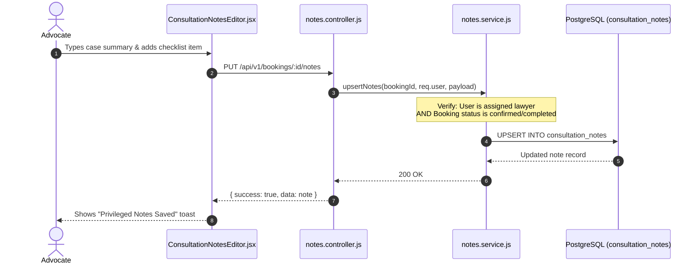
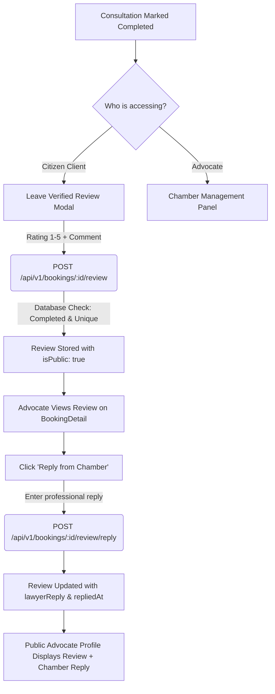

# Frontend Part 4: Post-Consultation Workflow — Notes, Reviews & Retainerships (FE-4)

Welcome to **Frontend Part 4** of the LegalHub FYP learning series. This guide documents the architecture, confidentiality guarantees, and regulatory safeguards governing the post-consultation legal workflow: privileged case work product (*Basta* notes), verified client reviews with chamber replies, and formal legal retainership engagements (*Vakalatnama*).

---

## 1. Pakistani Real-Life Analogies

To understand the legal boundaries and professional ethics implemented in this module, consider how physical legal proceedings unfold after a consultation at the High Court or District Bar:

### A. The Advocate's Case Brief & Privileged Bundle (*Basta*)
In Pakistani legal chambers, an advocate never mixes client-visible receipts with their internal, confidential legal strategy.
1. The advocate maintains a dedicated file folder or red cloth bundle (*Basta*).
2. Inside the *Basta*, the advocate jots down internal legal theories, cross-examination points, weakness assessments, and reminder checklists for the court clerk (*Munshi*).
3. Under **Article 9 of the Qanun-e-Shahadat Order 1984 (Law of Evidence)**, communications between an advocate and their client, as well as an advocate's personal case notes, are legally **privileged and confidential**.
4. Our **`ConsultationNotesEditor.jsx`** and `consultation_notes` table model this exact legal privilege: only the assigned advocate can view or edit notes. Clients can never inspect private chamber strategy notes.

### B. The Formal Power of Attorney (*Vakalatnama & Ongoing Engagement*)
A initial consultation is merely an advisory session (diagnosing the dispute). If the client decides to contest a civil revision or criminal trial, they must formally retain the advocate:
1. The litigant signs a **Vakalatnama** (formal legal appointment authorization).
2. The advocate enters appearance on behalf of the client before the judicial bench.
3. Our **`EngagementModal.jsx`** and `engagements` table model this transition: converting a completed advisory booking into an ongoing legal retainership with explicit title, practice area, and active status tracking.

### C. The Bar Council Shield Against Fabricated Reviews (*Rule 135 Compliance*)
Under **Rule 135 of the Legal Practitioners and Bar Councils Rules 1976**, commercial puffery and fake testimonials are strictly illegal.
1. Anonymous internet users or competitors cannot post defamatory or fake ratings on an advocate's profile.
2. A review can **only** be submitted if a genuine, completed consultation has concluded and been paid for in the system.
3. Advocates are given an official right of reply (**Chamber Response**) to clarify misunderstandings publicly on the record.

---

## 2. Architecture & File Catalog

| Component / File | File Path | Primary Responsibility |
| :--- | :--- | :--- |
| **`engagementApi`** | `frontend/src/api/engagement.api.js` | Axios client for creating, querying, and closing ongoing legal retainerships (`/api/v1/engagements`). |
| **`ConsultationNotesEditor`** | `frontend/src/components/ConsultationNotesEditor.jsx` | Privileged advocate workspace: case fact summary, dynamic action items checklist, and confidential strategy memos. |
| **`ConsultationNotesEditor.css`** | `frontend/src/components/ConsultationNotesEditor.css` | Styles for privileged badge, action item input pills, and autosave indicators. |
| **`ReviewModal`** | `frontend/src/components/ReviewModal.jsx` | Client feedback modal: 1–5 star interactive selector, character count validation (10–1000 chars), and submission handler. |
| **`ReviewModal.css`** | `frontend/src/components/ReviewModal.css` | Star hover micro-interactions, character counter, and validation styling. |
| **`ReviewReplyModal`** | `frontend/src/components/ReviewReplyModal.jsx` | Chamber response dialog allowing advocates to post a professional reply to client feedback. |
| **`EngagementModal`** | `frontend/src/components/EngagementModal.jsx` | Modal dialog for formal retainership initiation (*Vakalatnama* conversion) with pre-filled case details. |
| **`EngagementModal.css`** | `frontend/src/components/EngagementModal.css` | Form controls, retainership badge, and modal container styling. |
| **`BookingDetail`** | `frontend/src/pages/BookingDetail.jsx` | Integrates post-consultation panels: renders notes editor (for lawyers), review submission & display, and retainership links. |

---

## 3. Privileged Legal Notes Architecture



### Data Isolation Guarantee:
* The `consultation_notes` record is stored in a separate table from `bookings`.
* When a citizen client fetches booking details (`GET /api/v1/bookings/:id`), the API endpoint completely strips `consultation_notes` from the JSON response.
* Only the assigned advocate can call `GET /api/v1/bookings/:id/notes`, strictly guarded by the `requireApprovedLawyer` middleware and ownership validation in `notes.service.js`.

---

## 4. Verified-Only Reviews & Chamber Reply Flow



### Key Regulatory Rules:
1. **Zero Anonymous Reviews:** Reviews cannot be created through an arbitrary POST without a valid `bookingId` tied to the authenticated user.
2. **Single Review Constraint:** A partial unique index on `reviews.bookingId` ensures a litigant cannot spam multiple ratings for the same appointment.
3. **Chamber Right of Reply:** An advocate can add a single dignified response, helping address client questions or state procedural court outcomes transparently.

---

## 5. Ongoing Legal Retainerships (*Vakalatnama*)

When a citizen's legal problem requires formal litigation (e.g. filing a constitutional petition before the Lahore High Court Bench), the advisory consultation transitions to an **Engagement**:

```javascript
// Converting a Completed Booking into a Formal Engagement
const handleCreateEngagement = async (formData) => {
  const payload = {
    bookingId: booking.id,
    title: formData.title,
    practiceArea: formData.practiceArea,
    notes: formData.notes,
  };
  await engagementApi.createEngagement(payload);
  showToast('Legal Retainership initiated successfully!', 'success');
};
```

An engagement maintains an independent lifecycle:
* `status: 'active'`: The advocate is actively representing the client before the courts.
* `status: 'closed'`: The matter has reached a final judgment, decree, or out-of-court settlement.

---

## 6. Hands-on FYP Exercises for Students

### Exercise 1: Record Privileged Consultation Notes
1. Log in as Advocate Sardar Sikandar Hayat (`sikandar.hayat@example.com`).
2. Navigate to a completed consultation appointment detail page (`/bookings/:id`).
3. Under the **Privileged Case Work Product (*Basta*)** section:
   - Enter case summary: *"Litigant presented registered sale deed dated 14-Aug-2012. Mutation appears intact."*
   - Add action item: *"Draft suit for permanent injunction under Section 54 Specific Relief Act."*
   - Add private note: *"Limitation period expires next month."*
4. Click **Save Privileged Notes**. Verify success toast.
5. Log out and log in as the Client Ahmad Raza (`ahmad.raza@example.com`). Open the same booking page. Verify that the privileged notes section is completely invisible.

### Exercise 2: Submit Verified Review & Chamber Reply
1. As Client Ahmad Raza, open the completed booking.
2. Click **Write Verified Review**.
3. Select **5 Stars** and enter feedback: *"Advocate Sikandar provided exceptional legal clarity regarding our property title dispute."*
4. Submit review and observe immediate timeline update.
5. Log back in as Advocate Sikandar Hayat. Notice the new review card with a **Reply from Chamber** button.
6. Click **Reply from Chamber**, type: *"Thank you for consulting our chamber. We will ensure the draft petition is prepared promptly."*, and submit.
7. Verify that both the client review and the chamber reply are rendered in the timeline.

### Exercise 3: Initiate Legal Retainership (*Vakalatnama*)
1. As Advocate Sikandar Hayat on the completed booking, click **Convert to Legal Retainership**.
2. Set matter title: *"Suit for Declaration & Permanent Injunction - Multan District Courts"*.
3. Practice area: **Property**.
4. Submit. Verify that the engagement card links the booking to the ongoing representation file.

---

## 7. Viva Defense Questions & Answers

### Q1: Why are consultation notes stored in a separate table rather than added as a text column in `bookings`?
> **Answer:** Under the principle of least privilege and legal ethics (Article 9 of Qanun-e-Shahadat Order 1984), case strategy notes must be completely partitioned from transactional booking records. Storing them in `consultation_notes` ensures they are never inadvertently returned in client queries, serializers, or billing invoices.

### Q2: How does your review system comply with Rule 135 of the Pakistan Bar Council Rules 1976?
> **Answer:** Rule 135 prohibits soliciting and commercial advertising. Our system guarantees:
> 1. Only verified litigants who paid for and completed a consultation can leave feedback.
> 2. No advocate can purchase or solicit sponsored ratings.
> 3. Advocates cannot review themselves.
> 4. Reviews cannot be edited to artificially inflate scores.
> 5. Advocates have an official right of reply to ensure professional dignity.

### Q3: What is the purpose of the `engagements` table when you already have `bookings`?
> **Answer:** A consultation booking is a one-time advisory session (typically 30–60 minutes) to evaluate a grievance. If the client decides to contest a multi-month trial or petition, this requires a continuous representation (*Vakalatnama*) contract. The `engagements` table tracks this long-term relationship, allowing both parties to log court milestones, retainership status (`active` / `closed`), and matter closure dates independently of single consultation slots.

### Q4: Why can't a client write a review before the appointment status is `completed`?
> **Answer:** Permitting reviews before a consultation takes place would enable retaliatory ratings or fake reviews (e.g. rating a lawyer negatively because they declined an appointment due to a conflict of interest). A review is valid only after legal services have actually been rendered.
