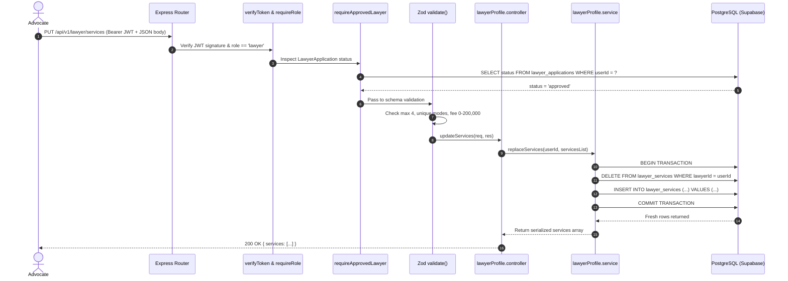

# LegalHub Backend — Part D: Lawyer Profile, Services, & Enriched Directory Guide

> **Academic Context:** Emerson University Multan — Final Year Project (BS Computer Science)  
> **Student Authors:** Syed Asad (Lead Developer), Muhammad Aqeel (Documentation & QA), Mubashir Mehmood (QA Support)  
> **Module Focus:** Post-Approval Advocate Profile Configuration, Consultation Services Replacement, and Rich Public Directory

---

## 1. High-Level Architectural Concept & Pakistani Real-Life Analogy 🇵🇰

### The Analogy
Imagine an advocate practicing at the **District Courts (*Katchery*) in Multan** or the **Lahore High Court**:
1. **Part B (The Official Bar Roster):** The advocate submitted their Bar Council card to the registrar. Once verified, their name was recorded in the Bar Association's official directory (*Wukala Register*).
2. **Part D (The Chamber Signboard & Service Menu):**  
   Now that their credentials are approved, the advocate establishes their private chamber:
   * **Outside the Chamber:** They mount a professional brass signboard (`lawyer_profiles`) displaying their headline (*"Appellate Advocate & Corporate Legal Advisor"*), client languages (*Urdu, Punjabi, Saraiki, English*), and standard appointment duration (*30 minutes*). If they go on annual court recess or leave, they can switch off their public visibility (*`isPublic: false`*).
   * **Inside the Chamber:** They establish their structured consultation menu (`lawyer_services`):
     * *In-Chamber Meeting* (45 mins, PKR 5,000)
     * *Video Conference* (30 mins, PKR 3,500)
     * *Phone Consultation* (15 mins, PKR 1,500)
     * *Written Legal Advice* (15 mins, PKR 1,000)

When a citizen searches the public portal, they see: *"Consultation from PKR 1,000"*, can filter by language, consultation mode, court jurisdiction, and sort by experience or fee in a completely transparent, deterministic manner.

---

## 2. Technical Definitions for Your Viva

* **Upsert (Insert or Update):** An idempotent database operation where the system inspects whether a row with a unique constraint (`userId`) already exists. If found, it updates the record; if absent, it inserts a new row.
* **Atomic Full-Set Replacement:** Rather than individual granular patch requests, the client submits the advocate's complete active set of services (up to 4). Within a single atomic database transaction, existing records are cleared and the new set is inserted, guaranteeing that duplicate modes and exceeding the 4-service cap are impossible.
* **Array Containment Operator (`@>`):** In PostgreSQL, `languages` are stored natively as `TEXT[]`. The query uses PostgreSQL's array operator or `ANY(...)` to search for advocates speaking a specified regional language (e.g. Saraiki or Sindhi) with maximum index efficiency.
* **Computed Directory Attributes (`feeFrom`, `modes[]`):** `feeFrom` is dynamically computed as the minimum `feePkr` across all active consultation services for that advocate. `modes[]` collects all distinct active consultation channels (`['chat', 'phone', 'video', 'in_chamber']`).
* **Rule 135 Sorting & Filtering Integrity:** In compliance with ethical legal guidelines, sorting by `fee_asc` or `experience` is purely mathematical and deterministic—never influenced by paid positioning or advertising.

---

## 3. Database Schema Specification

### `lawyer_profiles` Table
| Column | Type | Constraints | Description |
| :--- | :--- | :--- | :--- |
| `id` | UUID | Primary Key, UUIDV4 | Unique profile identifier |
| `userId` | UUID | Unique, FK $\rightarrow$ `users.id`, ON DELETE CASCADE | Associated advocate user account |
| `headline` | VARCHAR(120) | Nullable | Short professional summary |
| `about` | TEXT | Nullable, max 2000 chars | Detailed professional biography |
| `languages` | TEXT[] | Default `['Urdu', 'English']` | Regional languages spoken |
| `slotMinutes`| INTEGER | Default 30, Enum `(15, 30, 45, 60)` | Standard consultation duration |
| `isPublic` | BOOLEAN | Default `true` | Public directory visibility toggle |
| `createdAt` | TIMESTAMPTZ | Not Null | Creation timestamp |
| `updatedAt` | TIMESTAMPTZ | Not Null | Modification timestamp |

### `lawyer_services` Table
| Column | Type | Constraints | Description |
| :--- | :--- | :--- | :--- |
| `id` | UUID | Primary Key, UUIDV4 | Unique service identifier |
| `lawyerId` | UUID | FK $\rightarrow$ `users.id`, ON DELETE CASCADE | Associated advocate user account |
| `mode` | VARCHAR(20) | Enum `('chat', 'phone', 'video', 'in_chamber')` | Consultation medium |
| `durationMinutes` | INTEGER | Enum `(15, 30, 45, 60)` | Session duration |
| `feePkr` | INTEGER | Range `0` to `200,000` | Consultation fee in PKR |
| `isActive` | BOOLEAN | Default `true` | Active status toggle |
| `createdAt` | TIMESTAMPTZ | Not Null | Creation timestamp |
| `updatedAt` | TIMESTAMPTZ | Not Null | Modification timestamp |

*Composite Unique Index:* `(lawyerId, mode)` ensures an advocate cannot configure two conflicting services under the same consultation medium.

---

## 4. End-to-End Request Traces

### Trace 1: Saving Consultation Services (`PUT /api/v1/lawyer/services`)


### Trace 2: Enriched Public Directory Search (`GET /api/v1/lawyers?language=Saraiki&sort=fee_asc`)
1. **Client Request:** Sends `GET /api/v1/lawyers?language=Saraiki&sort=fee_asc`.
2. **Validation:** `validate(directoryQuerySchema, 'query')` verifies query arguments.
3. **Service Logic:**
   * Enforces `status = 'approved'`.
   * Enforces `isPublic != false` via SQL `NOT EXISTS` subquery on `lawyer_profiles`.
   * Matches language: `Saraiki = ANY(lawyer_profiles.languages)`.
   * Sorts deterministically using SQL subquery: `ORDER BY (SELECT MIN("feePkr") FROM lawyer_services ...) ASC NULLS LAST`.
4. **Data Projection:** `projectPublicDirectoryItem()` maps results, computing `feeFrom` and `modes[]`.
5. **Privacy Shield:** Strictly omits `email`, `enrolmentNo`, and `chamberAddress`.
6. **Response:** Resolves with `{ items: [...], total, page, limit }`.

---

## 5. Three Hands-On Viva / Development Exercises

### Exercise 1: Testing the Approved Status Guard
1. Register a new lawyer account and log in.
2. Attempt to call `GET /api/v1/lawyer/profile` before submitting an application.
3. *Expected Result:* `403 Forbidden` with explanation: *"You must submit and receive administrative approval for your advocate application before configuring profiles or services."*
4. Submit the application (its status is now `pending`) and call `GET /api/v1/lawyer/profile` again.
5. *Expected Result:* `403 Forbidden` indicating current status is `'pending'`.
6. Log in as admin, approve the application, and retry.
7. *Expected Result:* `200 OK` with default profile.

### Exercise 2: Enforcing the Maximum 4 Services and Duplicate Mode Limit
1. As an approved advocate, submit `PUT /api/v1/lawyer/services` with:
   ```json
   {
     "services": [
       { "mode": "video", "durationMinutes": 30, "feePkr": 2500 },
       { "mode": "video", "durationMinutes": 60, "feePkr": 4500 }
     ]
   }
   ```
2. *Expected Result:* `400 Bad Request` with Zod validation error: *"Duplicate consultation modes are not allowed in services list"*.

### Exercise 3: Testing the Profile Visibility Toggle (`isPublic: false`)
1. Query the public directory: `GET /api/v1/lawyers`. Locate your test advocate in the listing.
2. Update the advocate's profile: `PUT /api/v1/lawyer/profile` with `{ "isPublic": false, "languages": ["Urdu"] }`.
3. Re-query `GET /api/v1/lawyers`.
4. *Expected Result:* The advocate has disappeared from the public list.
5. Query their specific detail URL: `GET /api/v1/lawyers/:id`.
6. *Expected Result:* `404 Not Found` with message: *"Lawyer profile is currently private"*.

---

## 6. Five Viva Questions with Model Answers

### Q1: Why did you implement full-set replacement for `lawyer_services` instead of individual PATCH or POST endpoints?
> **Model Answer:** Individual granular endpoints introduce race conditions and state fragmentation (e.g. creating duplicate modes or exceeding the 4-service limit if multiple requests are sent concurrently). By wrapping a full-set replacement inside a single atomic database transaction (`DELETE` + `bulkCreate`), we guarantee state integrity, enforce the max-4 limit, and ensure that the stored service list always represents the exact current offerings configured by the advocate.

### Q2: How does the backend prevent an unverified advocate from setting consultation fees and advertising on the platform?
> **Model Answer:** We built a dedicated `requireApprovedLawyer` middleware. Before any request reaches profile or services controllers, the middleware verifies that the advocate holds an authenticated token and that their `LawyerApplication` in the database has an explicit status of `'approved'`. If the application is missing, pending, or rejected, the request is immediately aborted with a `403 Forbidden` response.

### Q3: How is `feeFrom` calculated in the public directory without causing an N+1 query performance bottleneck?
> **Model Answer:** In `directory.service.js`, we eagerly load active `services` using Sequelize's `include` with `distinct: true`. The minimum starting fee is computed in-memory during object projection or via a single SQL subquery in the order clause. This ensures that whether 1 or 50 advocates are returned on a page, exactly one single SQL query is executed against the database.

### Q4: Why does `GET /api/v1/lawyers/:id` return 404 when `isPublic = false`?
> **Model Answer:** If an advocate toggles their profile to private (for vacation, illness, or full court load), they should not be discoverable by direct bookmark link or web crawlers. Returning `404 Not Found` rather than a partial profile ensures privacy and avoids misleading clients into attempting to book an unavailable advocate.

### Q5: What security mechanism ensures that an advocate's personal email and chamber address are never leaked?
> **Model Answer:** We use the **Projection Pattern** (`projectPublicDirectoryItem` and `projectPublicLawyerDetail`). The controller never passes raw database records to `res.json()`. Instead, raw database instances pass through pure projection functions that explicitly whitelist public attributes (`id`, `name`, `city`, `courtLevel`, `practiceAreas`, `headline`, `about`, `languages`, `feeFrom`, `modes`). Sensitive internal fields (`email`, `enrolmentNo`, `chamberAddress`, `rejectionReason`, `reviewedBy`) are never included in the output object.

---

## 7. Common Pitfalls & Mistakes to Avoid

1. **Duplicate Rows in `findAndCountAll` When Joining HasMany:**
   * *Mistake:* Joining `LawyerService` (hasMany) without `distinct: true`. If a lawyer has 3 services, Sequelize's SQL join produces 3 rows for that single lawyer, corrupting pagination counts.
   * *Fix:* Always pass `distinct: true` in `findAndCountAll` when including `hasMany` relationships.
2. **Missing `ON DELETE CASCADE` on Relational Child Tables:**
   * *Mistake:* Deleting a user account fails with a foreign key constraint violation because child records exist in `lawyer_profiles` or `lawyer_services`.
   * *Fix:* Both migrations explicitly define `onDelete: 'CASCADE'` on foreign keys referencing `users(id)`.
3. **Case-Sensitive Language Matching:**
   * *Mistake:* Allowing arbitrary language casing causing search misses (e.g. `saraiki` vs `Saraiki`).
   * *Fix:* Enforce strict enum validation on `LANGUAGES` in Zod schemas and database models.
