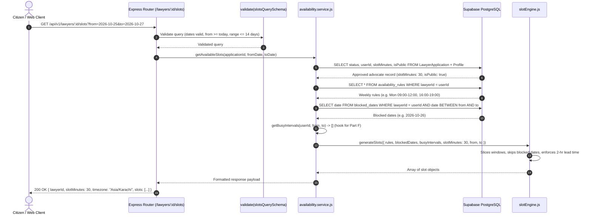

# Part E: Weekly Availability Rules, Blocked Dates, and Real-Time Slot Generator
**Emerson University Multan — Final Year Project (FYP) Learning & Viva Guide**  
**Working Title:** LegalHub (Pakistan Legal Services Marketplace)  
**Authors:** Syed Asad (Lead Developer), Muhammad Aqeel (Docs/QA), Mubashir Mehmood (QA Support)

---

## 1. Real-Life Pakistani Analogy: The Advocate's Munshi (*پیشی رجسٹر اور منشی صاحب*)

In a typical Pakistani District Court or High Court chamber (such as at the Multan District Courts or Lahore High Court), a senior advocate does not sit by the phone waiting for appointments.

- In the morning (09:00 AM to 01:00 PM), the advocate is busy appearing before the judges in courtroom hearings (*پیشی*).
- In the evening (04:00 PM to 08:00 PM), the advocate sits in their chamber holding consultation meetings with clients (*ملاقات*).
- On Fridays, they close early before Jummah prayer.
- On Sundays, the chamber is closed.

When a citizen walks into the chamber or calls to meet the advocate, they speak to the **Munshi** (*منشی*). The Munshi manages the chamber diary (*ڈائری*):
1. **Weekly Routine (Availability Rules):** The Munshi knows on which days and during which hours the advocate meets clients.
2. **Calendar Exceptions (Blocked Dates):** If the District Bar Association or High Court Bar Association calls for a strike (*ہڑتال / یومِ احتجاج*) or the High Court goes on summer vacation, the Munshi marks those days as **blocked**. No appointments are booked.
3. **Advance Notice Buffer (`MIN_LEAD_MINUTES = 120`):** The Munshi never agrees to an appointment 15 minutes from now. They say: *"Wakeel Sahab is currently occupied; the earliest token I can issue is at least 2 hours from now so the advocate can reach the chamber and review your file."*
4. **Time Slicing:** If the evening chamber window is 05:00 PM to 07:00 PM and the advocate offers 30-minute consultations, the Munshi prepares 4 tokens: 05:00, 05:30, 06:00, and 06:30.

**Part E builds this exact Munshi diary into LegalHub's backend.**

---

## 2. Technical Concepts Explained Simply

### 1. Wall-Clock Time vs. UTC Storage
- **Wall-Clock Time:** When an advocate configures their weekly hours, they think in Pakistan local time: *"I am available on Monday from 17:00 to 20:00"*. We store `startTime: "17:00"` and `endTime: "20:00"`.
- **Pakistan Standard Time (`Asia/Karachi`):** Pakistan is strictly **UTC+05:00 with no Daylight Saving Time (DST)**. 
- **UTC Output:** When a citizen requests available slots, our engine converts `"2026-10-25T17:00:00+05:00"` to its exact UTC equivalent `"2026-10-25T12:00:00.000Z"` alongside local formatted time. This ensures that web browsers and mobile apps across any device display the exact same time without timezone drift.

### 2. Discretized Time Window Slicing
- A continuous availability window (e.g. 09:00 to 12:00 = 180 minutes) is divided into discrete consultation slots using the advocate's configured `slotMinutes` (15, 30, 45, or 60 minutes).
- Slicing continues as long as `cursor + slotMinutes <= endMinutes`. If a window is 09:00 to 10:15 and slots are 30 minutes, it produces two slots: 09:00-09:30 and 09:30-10:00; the remaining 15 minutes are discarded because they cannot accommodate a full 30-minute consultation.

### 3. Minimum Lead Time Buffer (`MIN_LEAD_MINUTES = 120`)
- Prevents "walk-in surprise bookings".
- If the current time is 02:15 PM PKT, a client browsing slots cannot see or book a 02:30 PM slot. The earliest available slot must start at or after 04:15 PM (now + 2 hours).

### 4. Pure Deterministic Slot Engine (`slotEngine.js`)
- The core calculation is implemented as a **pure function** with no database or network dependencies:
  $$\text{generateSlots}(\{ \text{rules, blockedDates, busyIntervals, slotMinutes, fromDateStr, toDateStr, now} \})$$
- By accepting an injectable `now` provider function (`() => new Date()`), we can test any past, present, or future scenario without flaky system clock mocking.

### 5. Denial-of-Service Protection (14-Day Query Limit)
- Slicing dates into 15-minute intervals across years could consume excessive CPU and memory.
- `slotsQuerySchema` strictly enforces `(to - from) <= 14 days` and `from >= today`. Any larger range returns `400 Bad Request`.

---

## 3. End-to-End Request Trace (Slot Generation)



---

## 4. File-by-File Summary Table

| File | Type | Purpose & Non-Obvious Design Decision |
| :--- | :--- | :--- |
| `backend/migrations/20261021000001-create-availability-rules.js` | Migration | Creates `availability_rules` table with FK to `users.id` (CASCADE), index on `(lawyerId, weekday)`. |
| `backend/migrations/20261021000002-create-blocked-dates.js` | Migration | Creates `blocked_dates` table with FK to `users.id` and unique composite index `(lawyerId, date)`. |
| `backend/src/constants/availability.js` | Constants | Declares `TIMEZONE = 'Asia/Karachi'`, `MIN_LEAD_MINUTES = 120`, `MAX_SLOT_DAYS_LOOKAHEAD = 14`, `MAX_WINDOWS_PER_DAY = 3`. |
| `backend/src/models/availabilityRule.model.js` | Model | Sequelize model for weekly rules with weekday bounds (1-7) and "HH:MM" 24-hr regex validation. |
| `backend/src/models/blockedDate.model.js` | Model | Sequelize model for advocate calendar date blocks with ISO date validation. |
| `backend/src/models/index.js` | Associations | Connects `User` and `LawyerApplication` to `AvailabilityRule` and `BlockedDate` (`hasMany` / `belongsTo`). |
| `backend/src/modules/availability/availability.schemas.js` | Validation | Zod schemas with `superRefine` ensuring non-overlapping windows, max 3 windows per day, future dates only, and 14-day max range. |
| `backend/src/modules/availability/slotEngine.js` | Core Engine | Pure deterministic slot generator slicing time windows, checking lead time cutoff, and omitting blocked dates. |
| `backend/src/modules/availability/availability.service.js` | Service | Transaction-wrapped weekly rule replacement, blocked date management, and slot generation orchestration. |
| `backend/src/modules/availability/availability.controller.js` | Controller | Express HTTP handlers for advocate schedule endpoints and public slot query endpoint. |
| `backend/src/modules/lawyer/lawyer.routes.js` | Routing | Mounts `/availability` and `/blocked-dates` behind `authenticate`, `requireRole('lawyer')`, and `requireApprovedLawyer`. |
| `backend/src/modules/directory/directory.routes.js` | Routing | Mounts public `GET /lawyers/:id/slots` with `validate(slotsQuerySchema, 'query')`. |
| `backend/tests/availability.test.js` | Tests | 31 comprehensive integration and unit tests covering RBAC guards, rule validation, blocked dates, and slot generation. |

---

## 5. Three Hands-On Exercises for Emerson University Students

### Exercise 1: Triggering Overlapping Availability Validation
**Task:** Open Thunder Client or Postman and attempt to submit overlapping time windows for Monday (`weekday: 1`):
```json
{
  "rules": [
    { "weekday": 1, "startTime": "09:00", "endTime": "13:00" },
    { "weekday": 1, "startTime": "12:00", "endTime": "15:00" }
  ]
}
```
**Expected Output:** `400 Bad Request` with `error: "Validation failed"` and detail explanation:
`"Overlapping availability windows on weekday 1 (09:00-13:00 and 12:00-15:00)"`.

### Exercise 2: Testing Advance Notice Lead Time (`MIN_LEAD_MINUTES = 120`)
**Task:** In `tests/availability.test.js`, check test case 5.3:
```javascript
const simulatedNow = () => new Date('2026-10-19T05:15:00.000Z'); // 10:15 AM PKT
```
Notice why slots before 12:15 PM PKT are excluded:
- 10:15 AM + 2 hours = 12:15 PM.
- The 12:00 PM slot is discarded. The earliest returned slot is 12:30 PM.

### Exercise 3: Testing Blocked Date Omission
**Task:** Add a blocked date on a weekday that has availability rules. Query `GET /api/v1/lawyers/:id/slots` for that week.
**Observation:** The blocked date produces exactly 0 slots, while the unblocked weekdays retain their full slot schedule.

---

## 6. Five Viva Questions & Answers

### Q1: Why do we store availability rules as local "HH:MM" strings instead of UTC timestamps in the database?
**Answer:** Weekly availability is a recurring schedule tied to the advocate's local wall clock in Pakistan (e.g. *"Every Monday 5:00 PM to 8:00 PM"*). If we stored UTC timestamps, a recurring rule would break across calendar dates and complicate admin comprehension. Storing local time strings alongside weekday (1-7) makes the recurring rule clean, human-readable, and permanent. When slots are generated for a specific calendar date, they are converted to UTC.

### Q2: Why is the slot generation engine written as a pure function?
**Answer:** A pure function has no side effects and produces identical output given the same inputs. By separating slot generation logic from database queries and clock calls (`Date.now()`), the engine can be unit-tested thoroughly against edge cases (such as overlapping bookings, different slot durations, and leap years) without touching the database or waiting for real time to elapse.

### Q3: What is the purpose of `MIN_LEAD_MINUTES = 120`?
**Answer:** In legal practice, an advocate cannot handle surprise walk-in consultations booked 5 minutes in advance. The 120-minute lead time guarantees that an advocate has at least 2 hours of advance notice before a consultation begins, allowing them to travel to their chamber or prepare the legal case file.

### Q4: Why is the public slot query endpoint limited to a maximum of 14 days?
**Answer:** Without a limit, a malicious client could query `/slots?from=2026-01-01&to=2036-01-01` (10 years). Slicing 10 years of 15-minute slots would generate hundreds of thousands of objects in memory, potentially crashing the Node.js process (Denial of Service). A 14-day window provides ample booking foresight for clients while keeping query execution fast and lightweight.

### Q5: What role will `getBusyIntervals` play when Bookings are implemented in Part F?
**Answer:** `getBusyIntervals` acts as an extensible abstraction hook. In Part E, it returns an empty array `[]`. In Part F (Bookings), it will query the database for all confirmed or pending consultation appointments for that lawyer in the date range. The slot engine will then automatically exclude any time interval where the lawyer is already booked, ensuring no double-bookings can occur.

---

## 7. Common Student Pitfalls & Mistakes

1. **Floating Timezone Off-by-One Errors:** Constructing `new Date("2026-10-25")` in Node.js treats the string as UTC midnight. Depending on server timezone, `.getDay()` could return the previous day! Always specify midday UTC (`new Date("2026-10-25T12:00:00Z")`) when determining day of week.
2. **Missing Transaction on Full Replacement:** When updating weekly rules, if `destroy` succeeds but `bulkCreate` fails (due to a database disconnect), the advocate's entire schedule would be wiped out. Wrapping both operations in a Sequelize `transaction` ensures all-or-nothing atomicity.
3. **Hardcoding System Time in Tests:** Using `new Date()` directly inside the slot calculation makes automated tests non-deterministic. Injecting `nowProvider = () => new Date()` allows unit tests to freeze time to any specific second.
