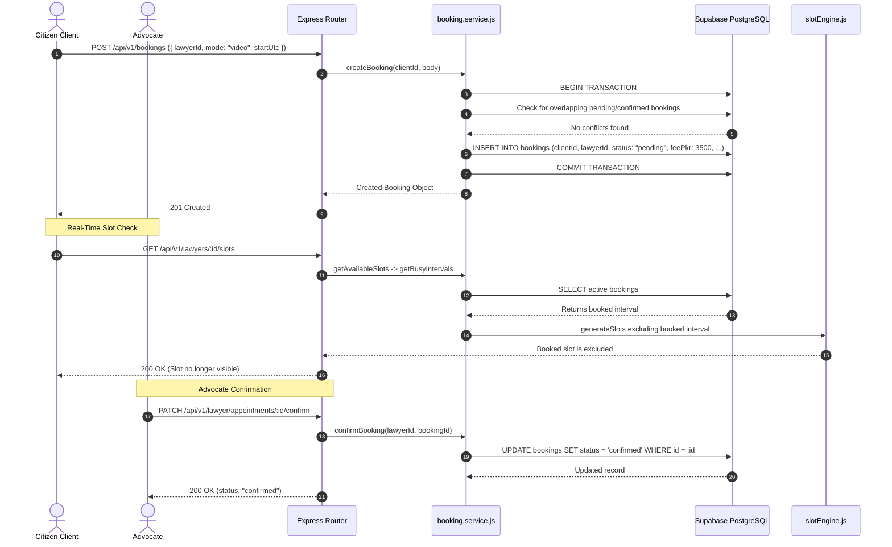

# Part F: Consultation Bookings & Appointment Lifecycle
**Emerson University Multan — Final Year Project (FYP) Learning & Viva Guide**  
**Working Title:** LegalHub (Pakistan Legal Services Marketplace)  
**Authors:** Syed Asad (Lead Developer), Muhammad Aqeel (Docs/QA), Mubashir Mehmood (QA Support)

---

## 1. Real-Life Pakistani Analogy: The Consultation Token (*وکیل صاحب سے وقت اور ملاقات کا ٹوکن*)

In Pakistan, when a citizen (e.g. from Khanewal, Lodhran, or Muzaffargarh) needs legal advice regarding an inheritance dispute, civil stay order, or tax matter, they visit the advocate’s chamber at the District Courts or High Court bench:

1. **The Booking Request (*درخواست برائے وقت*):** The litigant speaks with the Munshi (*منشی*) at the chamber desk and asks for an in-person meeting on Monday at 5:00 PM to discuss their case (*"زمین کی وراثت کا مقدمہ"*).
2. **Checking the Chamber Register (*ڈبل بکنگ کی روک تھام*):** The Munshi consults the chamber diary. If that 30-minute interval is already promised to another client, the Munshi immediately declines: *"That slot is already booked; I can offer you 5:30 PM."* If free, the Munshi writes down the appointment as **`pending`**.
3. **Advocate Review (*وکیل صاحب کی منظوری*):** The advocate reviews the appointment request:
   - If the advocate has no conflicting court appearance or conflict of interest, they **confirm** the consultation.
   - If an emergency hearing arises before a High Court Division Bench or the advocate cannot take the case, they **reject** the appointment with an explanation.
4. **Holding the Time Slot:** While an appointment is `pending` or `confirmed`, that exact time interval is **locked**. No other citizen browsing LegalHub can see or book that slot.
5. **Slot Release on Cancellation (*ٹوکن کی منسوخی اور وقت کی بحالی*):** If the client cancels due to personal travel, or the advocate declines, the Munshi erases the pencil mark from the diary. That slot immediately becomes available again for other litigants.
6. **Completion (*مشاورت کی تکمیل*):** Once the consultation takes place, the advocate marks it **`completed`** and records confidential case notes in the file.

**Part F implements this complete consultation transaction digitally.**

---

## 2. Technical Concepts Explained Simply

### 1. Transactional Concurrency & Double-Booking Prevention
When a client books an appointment, multiple clients might attempt to book the exact same 30-minute slot simultaneously.
To prevent double-booking, the backend executes inside a database **transaction**:
```sql
SELECT id FROM bookings
WHERE lawyer_id = :lawyerId
  AND status IN ('pending', 'confirmed')
  AND start_utc < :requestedEndUtc
  AND end_utc > :requestedStartUtc;
```
If any matching record is found, the transaction is aborted and the server returns `409 Conflict` (`"This time slot is already booked or reserved by another client"`).

### 2. Snapshotting Fee and Duration
A lawyer’s consultation fee might change over time (e.g. 3,000 PKR today, 5,000 PKR next month).
- We **never** calculate historic consultation earnings by looking up current service pricing.
- At the exact moment of booking, the system captures `feePkr` and `durationMinutes` as immutable snapshot attributes on the `Booking` record. Even if the lawyer updates their service fee later, the agreed price for that consultation remains locked.

### 3. Real-Time Slot Engine Integration (`getBusyIntervals`)
In Part E, the slot engine had a placeholder `getBusyIntervals` returning `[]`.
In Part F, `getBusyIntervals(lawyerId, fromDate, toDate)` queries all active bookings (`status IN ('pending', 'confirmed')`) for that lawyer in the date range.
- The slot engine automatically omits any time interval that overlaps an active booking.
- When an appointment is `rejected` or `cancelled`, it drops out of `ACTIVE_BOOKING_STATUSES` and the slot **instantly reappears** in public search!

### 4. Finite State Machine for Consultation Appointments
```
           [ Client Books ]
                  |
                  v
             ( PENDING )
            /     |     \
   Advocate/      |      \Advocate
  Confirms/   Cancelled   \Rejects
         v        |        v
    (CONFIRMED)   |   (REJECTED) [Slot Released]
       /     \    |
Advocate/    Cancelled
Completes/        v
     v       (CANCELLED) [Slot Released]
(COMPLETED)
```
- Only legal state transitions are permitted. For instance, attempting to complete an appointment that is still `pending`, or cancelling an appointment that is already `completed`, returns `409 Conflict`.

### 5. Minimum Lead Time Buffer (`MIN_LEAD_MINUTES = 120`)
A client cannot book an appointment starting in 15 minutes. The booking validator strictly enforces that `startUtc >= Date.now() + 120 minutes`, ensuring the advocate has at least 2 hours of advance notice.

---

## 3. End-to-End Request Trace (Booking Lifecycle)



---

## 4. File-by-File Summary Table

| File | Type | Purpose & Design Decision |
| :--- | :--- | :--- |
| `backend/migrations/20261022000001-create-bookings.js` | Migration | Creates `bookings` table with foreign keys to `users.id` (client & lawyer) and `lawyer_services.id`, plus interval indexes. |
| `backend/src/constants/booking.js` | Constants | Declares `BOOKING_STATUS` (`pending`, `confirmed`, `rejected`, `cancelled`, `completed`) and `ACTIVE_BOOKING_STATUSES`. |
| `backend/src/models/booking.model.js` | Model | Sequelize model for consultation bookings with mode, duration, and fee validations. |
| `backend/src/models/index.js` | Associations | Connects `User` (as `client` and `lawyer`), `LawyerApplication`, and `LawyerService` to `Booking`. |
| `backend/src/modules/booking/booking.schemas.js` | Validation | Zod schemas enforcing 2-hour lead time, valid modes, rejection reasons ($\ge$ 5 chars), and cancellation reasons. |
| `backend/src/modules/booking/booking.service.js` | Service | Transactional conflict detection, snapshotting fee/duration, lifecycle state machine, and appointment queries. |
| `backend/src/modules/booking/booking.controller.js` | Controller | Handlers for client booking creation, client appointment list, advocate confirmation, rejection, cancellation, and completion. |
| `backend/src/modules/booking/booking.routes.js` | Routing | Client appointment endpoints mounted under `/api/v1/bookings`. |
| `backend/src/modules/lawyer/lawyer.routes.js` | Routing | Advocate appointment endpoints mounted under `/api/v1/lawyer/appointments` (guarded by `requireApprovedLawyer`). |
| `backend/src/modules/availability/availability.service.js` | Integration | Connected `getBusyIntervals` to query active bookings from the `Booking` model. |
| `backend/src/app.js` | Mounting | Mounted `/api/v1/bookings` in Express app. |
| `backend/tests/booking.test.js` | Tests | 23 integration tests covering RBAC guards, concurrency conflict prevention, slot hiding/reappearance, and state machine transitions. |

---

## 5. Three Hands-On Exercises for Emerson University Students

### Exercise 1: Triggering Double-Booking Prevention (409 Conflict)
**Task:** Using Postman or Thunder Client, submit a booking request for an advocate's slot (e.g. 5:00 PM to 5:30 PM). With a second client account, immediately submit the exact same slot request.
**Observation:** The second request receives `409 Conflict` with the explanation:
`"This time slot is already booked or reserved by another client"`.

### Exercise 2: Verifying Real-Time Slot Engine Exclusion
**Task:** Query `GET /api/v1/lawyers/:id/slots` before booking a slot. Notice the slot is present. Create a booking for that slot. Query the slots endpoint again.
**Observation:** The booked slot has completely vanished from the available slots array because `getBusyIntervals` returned it as an active interval.

### Exercise 3: Testing Slot Reappearance upon Rejection
**Task:** As the advocate, reject the booking using `PATCH /api/v1/lawyer/appointments/:id/reject` with a reason. Now re-run `GET /api/v1/lawyers/:id/slots`.
**Observation:** The 5:00 PM slot immediately reappears in the public schedule, allowing other citizens to book it!

---

## 6. Five Viva Questions & Answers

### Q1: What database anomaly could occur if two clients book the same slot at the same second, and how did you prevent it?
**Answer:** A "race condition" or double-booking anomaly could occur where two concurrent requests read the slot as available and both insert bookings. We prevented this by wrapping the availability check and booking insertion inside a single database **transaction**. The query searches for any active booking (`pending` or `confirmed`) where `startUtc < newEndUtc AND endUtc > newStartUtc`. If a conflict exists, the transaction fails and returns `409 Conflict`.

### Q2: Why is the consultation fee stored directly on the `Booking` record instead of referencing `LawyerService.feePkr`?
**Answer:** This is called **price snapshotting**. If an advocate charges 3,000 PKR when a client books today, but raises their price to 6,000 PKR tomorrow, querying the fee via relation would corrupt the client’s historical invoice. Storing `feePkr` directly on the `Booking` record permanently preserves the financial terms agreed upon at the time of booking.

### Q3: Why does a `pending` booking hold the slot just like a `confirmed` booking?
**Answer:** If `pending` bookings did not lock the slot, multiple clients could send booking requests for the same 5:00 PM slot. When the advocate confirmed one, the others would be broken. Treating `pending` as an active reservation ensures that once a client takes the initiative to request a token, that token is held until the advocate confirms or rejects it.

### Q4: What happens if an advocate rejects a booking? Is the slot lost?
**Answer:** No. When an advocate rejects an appointment, its status changes to `rejected`. Because `getBusyIntervals` only filters bookings with status `pending` or `confirmed`, the rejected booking is ignored, and the slot generation engine instantly makes the slot visible again for other clients.

### Q5: How is client privacy protected during booking?
**Answer:** Only the client who booked the appointment and the assigned advocate can view the booking details (`GET /api/v1/bookings/:id`). Any other user (e.g. another client) attempting to access the booking receives `403 Forbidden`. Furthermore, public endpoints never expose client notes or booking histories.

---

## 7. Common Student Pitfalls & Mistakes

1. **Incorrect Overlap Math:** A common mistake is checking `startUtc === existing.startUtc`. If one service is 60 minutes (05:00-06:00) and another is 30 minutes (05:30-06:00), checking exact equality will fail! The correct interval overlap formula is `newStart < existingEnd AND existingStart < newEnd`.
2. **Forgetting Timezone Conversion on Booking Dates:** When a client sends a UTC timestamp (`2026-10-25T12:00:00Z`), slicing the date string requires keeping Pakistan time in mind. If UTC is converted naively, a 1:00 AM PKT appointment might be credited to the previous calendar day.
3. **Allowing Past Cancellations:** Clients should not be permitted to cancel appointments after the meeting has already started or concluded. Checking `new Date(booking.startUtc) < new Date()` prevents retroactively cancelling attended meetings.
