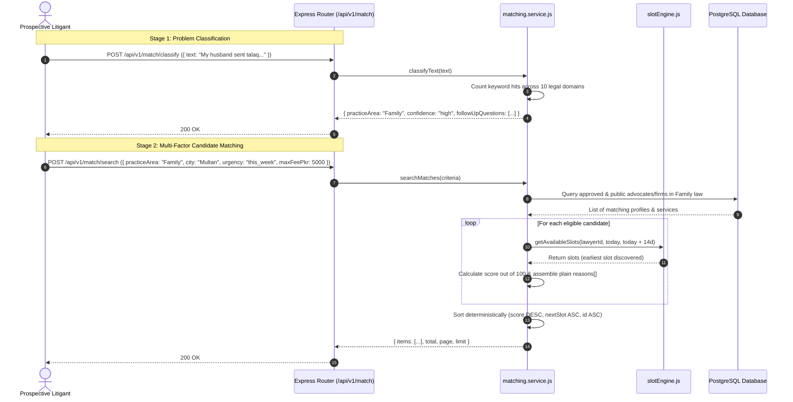

# Part F: Rule-Based Matching Engine
**Emerson University Multan — Final Year Project (FYP) Learning & Viva Guide**  
**Working Title:** LegalHub (Pakistan Legal Services Marketplace)  
**Authors:** Syed Asad (Lead Developer), Muhammad Aqeel (Docs/QA), Mubashir Mehmood (QA Support)

---

## 1. Real-Life Pakistani Analogy: The District Court Reader (*کچہری کا رہنمائی ڈیسک*)

When an ordinary citizen from a rural tehsil (e.g. Shujabad, Lodhran, or Jalalpur Pirwala) visits the District Courts (*ضلعی کچہری*) in Multan for the first time, they face a bewildering maze of courtrooms, benches, and hundreds of nameplates. They know their personal grievance, but they do not know what branch of the law governs it:

1. **The Chamber Question (*مسئلے کی زبانی وضاحت*):** The citizen approaches the court information counter or a senior reader (*ریڈر یا منشی*):
   > *"My brother sold our joint ancestral agricultural land without taking my consent or sharing the mutation record (Fard). What should I do?"*
2. **Intent Classification (`/match/classify`):** The reader listens to the key words (*"ancestral land"*, *"mutation"*, *"Fard"*, *"consent"*) and determines:
   > *"This is primarily a **Property / Civil** matter involving revenue records and inheritance."*
   The reader classifies the inquiry with high confidence and asks diagnostic follow-up questions: *"Which tehsil is the land located in? Do you need an urgent stay order this week? Do you have the registered deed?"*
3. **Impartial Advocate & Firm Matching (`/match/search`):** Under Rule 135 of the Legal Practitioners and Bar Councils Rules 1976, advocates are prohibited from commercial solicitation or self-advertising. The reader cannot say *"Advocate X is the best lawyer in Multan"*. Instead, the reader reviews the registry objectively:
   - Matches lawyers and firms practicing **Property law** in **Multan**.
   - Filters for those who speak **Saraiki** or **Urdu** to ensure easy communication.
   - Verifies who has an open consultation slot available this week.
   - Checks the citizen's budget (e.g., under 4,000 PKR).
   - Generates transparent, factual reasons: *"Advocate A practices Property law in Multan, offers in-chamber consultations within your 4,000 PKR budget, and has an open slot tomorrow at 5:00 PM."*

**Part F implements this exact two-stage rule-based matching engine digitally.**

---

## 2. Technical Concepts Explained Simply

### 1. Whole-Word Regex Matching vs. Substring Collision
When classifying text, simple substring search (e.g., `text.includes("bail")`) produces false positives (e.g. *"The corporation received a financial **bail**out"*).
- The matching engine uses regex word boundaries:
  ```javascript
  const pattern = new RegExp(`\\b${escapeRegex(kw)}\\b`, 'i');
  ```
- This ensures only genuine legal usages trigger the practice area counters.

### 2. Confidence Metric (`high` | `low` | `none`)
The classifier evaluates the distribution of keyword hits across all 10 practice areas:
- **`high`:** The top area has $\ge 2$ keyword hits AND leads the runner-up area by $\ge 1$ hit (clear majority).
- **`low`:** The top area has only 1 keyword hit, or there is a numerical tie between two top areas.
- **`none`:** Exactly 0 keywords matched anywhere in the text.

### 3. The 100-Point Objective Matching Matrix
When searching for candidates, scoring is strictly non-monetized and objective:
$$\text{Score} = \text{City (30)} + \text{Urgency (25)} + \text{Mode (15)} + \text{Budget (10)} + \text{Language (10)} + \text{Experience (10)}$$

1. **City (30 pts):** Advocate's chamber matches the user's city.
2. **Urgency & Availability (25 or 10 pts):**
   - User needs consultation `today` and advocate has a slot within 24 hours: **+25 pts**.
   - User needs consultation `this_week` and advocate has a slot within 7 days: **+25 pts**.
   - User is `flexible` and advocate has a slot within 14 days: **+10 pts**.
3. **Consultation Mode (15 pts):** Advocate has an active service in the requested mode (`video`, `in_chamber`, etc.).
4. **Fee Budget (10 pts):** Advocate's consultation fee is $\le$ `maxFeePkr`.
5. **Language (10 pts):** Advocate speaks user's requested regional language (`Urdu`, `Saraiki`, `Punjabi`, `Sindhi`, `Pashto`, `English`).
6. **Experience (10 pts):** Scaled pro-rata up to 15 years:
   $$\text{ExpPoints} = \text{round}\left( \frac{\min(\text{years}, 15)}{15} \times 10 \right)$$

### 4. Bar Council Rule 135 Anti-Solicitation Guard
Under Pakistani legal ethics, algorithms that display "Top Lawyers", "Featured Advocates", or "Highest Rated" are strictly forbidden:
- Rating stars and commercial factors are **never** part of the match score.
- The `reasons[]` array contains strictly factual sentences like:
  - *"Practises Corporate law"*
  - *"Based in Multan"*
  - *"Consults in Saraiki"*
  - *"Offers video consultations"*
  - *"15 years of professional legal experience"*
- The system asserts that words like "best", "top", "premier", and "featured" are **never** rendered.

### 5. Seamless Law Firm (`role: law_firm`) Inclusion
Law firms registered on the platform are evaluated on the exact same objective matrix as individual advocates. When a citizen searches for corporate or banking counsel, law firms practicing in that city with active services appear side-by-side with individual advocates.

---

## 3. End-to-End Request Trace



---

## 4. File-by-File Summary Table

| File | Purpose & Responsibilities |
| :--- | :--- |
| `src/constants/matching.js` | Curated starter keyword lists per practice area, generic & category follow-up intake questions, and scoring weights (City: 30, Urgency: 25, Mode: 15, Budget: 10, Language: 10, Exp: 10). |
| `src/constants/index.js` | Re-exports all matching constants for clean modular imports. |
| `src/modules/matching/matching.schemas.js` | Zod validation schemas for text input (10–1000 chars) and structured search criteria. |
| `src/modules/matching/matching.service.js` | Core algorithms: whole-word regex classification, multi-factor scoring matrix, integration with `getAvailableSlots`, Rule 135 compliant reason generator. |
| `src/modules/matching/matching.controller.js` | Express request handlers dispatching to `matching.service.js`. |
| `src/modules/matching/matching.routes.js` | Public Express router mounted at `/api/v1/match`. |
| `src/modules/availability/slotEngine.js` | Updated slot object generator to return both `startsAt` and `startUtc` for backward and forward compatibility. |
| `src/app.js` | Mounts `/api/v1/match` into the central application pipeline. |
| `tests/matching.test.js` | 13 integration tests verifying classification confidence, scoring matrix accuracy, law firm inclusion, Rule 135 compliance, and pagination. |

---

## 5. Hands-on Exercises for Students

### Exercise 1: Expanding the Regional Keyword Dictionary
Open `src/constants/matching.js`. Add 3 common regional Punjabi/Saraiki legal terms to the `Property` dictionary (e.g. `"bana"` for field boundary, `"chahi"` for irrigated land, `"khasra"` for survey number). Run `npm.cmd test -- tests/matching.test.js` to ensure zero syntax errors.

### Exercise 2: Inspecting Rule 135 Compliance via Jest
In `tests/matching.test.js`, review the test `"should strictly comply with Bar Council Rule 135"`. Modify `matching.service.js` temporarily to add `"Top rated corporate counsel"` into `reasons[]`. Run the test to observe how the automated compliance test catches the violation, then restore the compliant code.

### Exercise 3: Adjusting Urgency Scoring Weights
In `src/constants/matching.js`, change `MATCHING_WEIGHTS.URGENCY_TODAY` from 25 to 30 and `MATCHING_WEIGHTS.CITY` from 30 to 25. Update the expected score in `tests/matching.test.js` and verify how weighting changes shift the relative ranking of candidates.

---

## 6. Viva Voce Questions & Answers

### Q1: Why use deterministic rule-based keyword matching instead of an LLM for classification?
**Answer:** A Final Year Project for an academic institution requires high reliability, predictable latency, zero API costs, and complete determinism. An LLM API can hallucinate, suffer from network downtime, and leak user queries to third parties. Our whole-word regex classification runs in sub-millisecond time locally on the server with 100% testable accuracy.

### Q2: Why are ratings and reviews excluded from the matching score?
**Answer:** Under Rule 135 of the Legal Practitioners and Bar Councils Rules 1976, Pakistani advocates are prohibited from commercial advertising or public ranking. If ratings influenced match scores, it would create a commercial popularity contest where high-volume chambers crowd out reputable senior practitioners. By law and ethics, LegalHub uses only objective criteria (jurisdiction, language, mode, availability, verified domain practice).

### Q3: How does the system prevent substring collisions like "bailout" triggering "bail"?
**Answer:** We compile each keyword with regex word boundary assertions: `\b${keyword}\b` with case-insensitive flag `'i'`. Therefore, `"bailout"` does not match because the trailing word boundary does not follow `"bail"`.

### Q4: How does the matching engine discover the advocate's next available slot?
**Answer:** In `searchMatches`, the service calls Part E's `getAvailableSlots(app.id, today, today + 14d)`. The pure slot engine checks the advocate's weekly rules, filters out blocked dates, subtracts active consultation bookings, and discards slots within the 2-hour lead buffer. The earliest resulting slot is returned in `nextSlot` and used to award urgency points.

### Q5: How are Law Firms accommodated alongside individual advocates?
**Answer:** In the database, Law Firms hold `role: 'law_firm'` on the `users` table and maintain an approved application on `lawyer_applications`. When a litigant executes a search, the query matches all entities that practice that domain, surfacing law firms with their commercial portfolio and consultation modes without discrimination.

---

## 7. Common Pitfalls & Mistakes

1. **Confusing Filtering with Scoring:** In `searchMatches`, `practiceArea` is an eligibility filter (candidates without it are excluded). In contrast, `city`, `mode`, and `language` are **scoring weights** (candidates from other cities are still returned, but ranked lower). Confusing the two would prevent users from seeing specialized appellate advocates in provincial capitals when no local advocate exists.
2. **Missing PKT Wall-Clock Offset:** Calculating urgency hours using raw local wall-clock strings instead of ISO UTC timestamps causes a 5-hour error, incorrectly flagging morning slots as past slots.
3. **Hardcoding Superlatives:** Using phrases like *"Multan's leading corporate advocate"* in `reasons[]` is a direct violation of Pakistan Bar Council statutory ethics.
