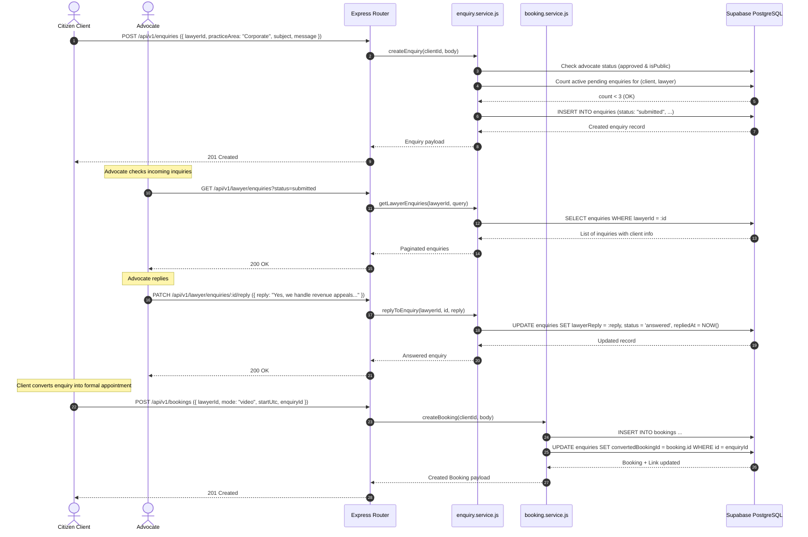

# Part G: Pre-Booking Enquiries & Lead Pipeline
**Emerson University Multan — Final Year Project (FYP) Learning & Viva Guide**  
**Working Title:** LegalHub (Pakistan Legal Services Marketplace)  
**Authors:** Syed Asad (Lead Developer), Muhammad Aqeel (Docs/QA), Mubashir Mehmood (QA Support)

---

## 1. Real-Life Pakistani Analogy: The Preliminary Chamber Inquiry (*ابتدائی قانونی استفسار اور مشاورت سے پہلے کا مرحلہ*)

In Pakistani legal culture, citizens rarely jump straight into booking a paid consultation before knowing if the advocate handles their specific kind of case. 

Consider a citizen from Multan whose family agricultural land in Kabirwala or Shujabad is subject to a partition dispute (*"زمین کی تقسیم اور وراثت کا تنازعہ"*):
1. **The Chamber Question (*ابتدائی سوال*):** Before booking a 45-minute chamber meeting or paying a formal consultation retainer, the litigant approaches the advocate’s chamber or sends an introductory note:
   > *"Advocate Sahib, I have a revenue record dispute regarding mutation (intiqal) in Mauza Shujabad. Do you take up revenue cases before the Additional Deputy Commissioner (Revenue)?"*
2. **Advocate Preliminary Assessment (*وکیل صاحب کا مختصر جواب*):** The advocate reviews the note. Rather than charging immediately, the advocate provides a brief preliminary reply:
   > *"Yes, our chamber represents revenue matters and appeals. Please book a 30-minute consultation slot so we can examine the Fard and Aks Shajra."*
3. **Preventing Chamber Harassment & Spam (*فضول سوالات اور ہراسانی کی روک تھام*):** If one persistent individual sends 20 unsolicited letters demanding free advice, the Munshi steps in: *"Advocate Sahib has not replied to your earlier letters yet; you cannot submit more requests until the current inquiry is addressed."*
4. **Transition from Lead to Formal Appointment (*استفسار کا باقاعدہ مشاورت میں تبادلہ*):** Once the advocate confirms they handle that legal domain, the litigant books a formal video or chamber consultation. The system links the previous inquiry directly to the appointment docket so the advocate has full context.

**Part G implements this preliminary enquiry and lead pipeline digitally.**

---

## 2. Technical Concepts Explained Simply

### 1. Pre-Booking Lead Funnel vs. Instant Appointments
A consultation booking (`/api/v1/bookings`) commits a calendar slot and charges a consultation fee. An enquiry (`/api/v1/enquiries`), on the other hand, is a lightweight, non-binding preliminary query:
- It allows prospective clients to verify domain fit, chamber availability, or case feasibility.
- It enables advocates to screen inquiries before committing consultation time.

### 2. Pair-Wise Anti-Spam Quota (`MAX_PENDING_ENQUIRIES_PER_PAIR = 3`)
To prevent malicious clients or competitors from overwhelming an advocate with spam:
```javascript
const pendingCount = await Enquiry.count({
  where: {
    clientId,
    lawyerId: app.userId,
    status: ENQUIRY_STATUS.SUBMITTED
  }
});

if (pendingCount >= MAX_PENDING_ENQUIRIES_PER_PAIR) {
  throw new AppError(
    'You have reached the maximum limit of 3 pending enquiries for this advocate. Please await a reply or close prior enquiries.',
    429
  );
}
```
- Only active/unanswered (`submitted`) enquiries count toward this quota.
- Once the advocate answers or either party closes an enquiry, the slot frees up.

### 3. Regulatory Safety Under Rule 135
Under Rule 135 of the Legal Practitioners and Bar Councils Rules 1976, Pakistani advocates are prohibited from commercial solicitation or advertising.
- **Client-Initiated Only:** Advocates cannot initiate cold-outreach or send unsolicited messages to users.
- **Purely Responsive:** The advocate only replies to queries explicitly sent to them by a citizen.
- **No Sponsored Leads:** Enquiries are routed directly and organically based on directory discovery, without pay-per-lead or bidding mechanisms.

### 4. Seamless Lead Conversion (`convertedBookingId`)
When a client decides to schedule an appointment after receiving an answer:
- The client passes optional `enquiryId` in `POST /api/v1/bookings`.
- Within the database transaction, the backend updates `Enquiry.convertedBookingId = booking.id`.
- Both the client and advocate can trace the appointment back to the initial inquiry.

### 5. Multi-Party Authorization
An enquiry involves sensitive case details:
- **Client Access:** Can view only their own submitted enquiries (`clientId === req.user.id`).
- **Advocate Access:** Can view only enquiries directed to their chamber (`lawyerId === req.user.id`).
- **Admin Access:** Can view for dispute resolution and platform moderation.
- Any attempt by third-party users to view or reply returns `403 Forbidden`.

---

## 3. End-to-End Request Trace (Enquiry to Booking Conversion)



---

## 4. File-by-File Summary Table

| File | Purpose & Responsibilities |
| :--- | :--- |
| `migrations/20261023000001-create-enquiries.js` | Database migration creating `enquiries` table with foreign keys to `users` and `bookings`, and indexes on `(lawyerId, status)` and `(clientId, status)`. |
| `src/constants/enquiry.js` | Exports `ENQUIRY_STATUS` (`submitted`, `answered`, `closed`), `ALLOWED_ENQUIRY_STATUSES`, and `MAX_PENDING_ENQUIRIES_PER_PAIR = 3`. |
| `src/models/enquiry.model.js` | Sequelize model definition with field constraints, status validation, and index specifications. |
| `src/models/index.js` | Configures model associations between `User`, `LawyerApplication`, `Booking`, and `Enquiry`. |
| `src/modules/enquiry/enquiry.schemas.js` | Zod validation schemas for creating enquiries, advocate replies, query pagination, and UUID route parameters. |
| `src/modules/enquiry/enquiry.service.js` | Business logic for submitting inquiries, anti-spam validation, lawyer replies, client listing, and enquiry closure. |
| `src/modules/enquiry/enquiry.controller.js` | Express HTTP request handlers dispatching to `enquiry.service.js`. |
| `src/modules/enquiry/enquiry.routes.js` | Express router mounted at `/api/v1/enquiries` protected by JWT authentication and client RBAC. |
| `src/modules/lawyer/lawyer.routes.js` | Updated with advocate enquiry endpoints (`GET /enquiries`, `PATCH /enquiries/:id/reply`) guarded by `requireApprovedLawyer`. |
| `src/app.js` | Mounts `/api/v1/enquiries` router into the central Express application pipeline. |
| `tests/enquiry.test.js` | 19 integration tests verifying RBAC, validation, anti-spam throttling, advocate replies, closing, and booking conversion. |

---

## 5. Hands-on Exercises for Students

### Exercise 1: Enforce Minimum Enquiry Body Length in Zod
Inspect `src/modules/enquiry/enquiry.schemas.js`. If a student wants to ensure prospective clients provide sufficient context (preventing one-liners like *"Call me"*), change the minimum message length from 10 to 30 characters. Run `npm.cmd test -- tests/enquiry.test.js` and observe which test fails, then update the test payload accordingly.

### Exercise 2: Anti-Spam Expiry Window
Currently, `MAX_PENDING_ENQUIRIES_PER_PAIR = 3` checks active enquiries regardless of age. How would you modify the count query in `src/modules/enquiry/enquiry.service.js` using Sequelize `Op.gte` to only count pending enquiries submitted within the last 7 days?

### Exercise 3: Filter Enquiries by Practice Area
Add an optional query filter `practiceArea` to `listEnquiriesQuerySchema` in `enquiry.schemas.js` and wire it into the `where` clause in `getLawyerEnquiries`. Verify that advocates can view only their pending "Corporate" or "Civil" enquiries.

---

## 6. Viva Voce Questions & Answers

### Q1: Why do we have an Enquiry module if we already have Consultation Bookings?
**Answer:** A consultation booking reserves a specific time slot on the advocate's calendar and snapshot-locks a fee. Many Pakistani litigants are unsure whether an advocate practices in the relevant jurisdiction (e.g. Service Tribunal vs High Court) or whether their case has merit. The Enquiry module provides an asynchronous, zero-commitment preliminary channel. It prevents wasted booking fees and avoids calendar clogging with unqualified inquiries.

### Q2: How does the platform protect advocates from spam without introducing paid paywalls?
**Answer:** We implement pair-wise application-level throttling: `MAX_PENDING_ENQUIRIES_PER_PAIR = 3`. A single client cannot have more than 3 active (`submitted`) enquiries with the same advocate at any one time. If the client wants to ask another question, they must either wait for the advocate to reply or close a prior enquiry. This prevents denial-of-service spam while remaining fully compliant with Bar Council rules prohibiting pay-to-access models.

### Q3: Why is cold outreach by advocates prohibited on LegalHub?
**Answer:** Under Rule 135 of the Legal Practitioners and Bar Councils Rules 1976, advocates enrolled in Pakistan are prohibited from soliciting briefs or advertising their legal services. Cold outreach (lawyers messaging clients first) constitutes direct commercial solicitation. LegalHub strictly enforces client-initiated contact: advocates can only respond to queries voluntarily sent to them by citizens.

### Q4: How does lead conversion work between Enquiry and Booking?
**Answer:** The `enquiries` table includes a nullable foreign key `convertedBookingId` referencing `bookings.id`. When a client proceeds to book a consultation, they optionally provide `enquiryId`. In `booking.service.js`, inside the database transaction, `enquiry.update({ convertedBookingId: booking.id })` is executed. This links the initial discussion directly to the formal consultation record.

### Q5: What happens if an advocate closes their profile (`isPublic: false`)?
**Answer:** When an advocate sets `isPublic: false` in their profile, `createEnquiry` throws a `404 Not Found` with message *"Advocate is currently not accepting new enquiries"*. This respects the advocate's availability when they are on court leave, taking a sabbatical, or managing full chamber caseloads.

---

## 7. Common Pitfalls & Mistakes

1. **Forgetting to Check `isPublic` on Lawyer Profile:** Looking only at `application.status === 'approved'` without checking `profile.isPublic` would allow clients to send inquiries to lawyers who have temporarily paused their digital intake.
2. **Missing Pair-Wise Throttling:** Applying a global rate limit (e.g. 10 enquiries per day) instead of pair-wise throttling (`clientId + lawyerId`) fails to stop a malicious actor from spamming a single competitor advocate with 50 enquiries in minutes.
3. **Leaving Closed Enquiries in Count:** When calculating active pending inquiries, the query must specifically check `status: ENQUIRY_STATUS.SUBMITTED`. If `answered` or `closed` inquiries are accidentally counted, legitimate clients would be permanently blocked from consulting that advocate.
4. **Allowing Third-Party Reply:** Forgetting to check `enquiry.lawyerId === lawyerUserId` before updating the reply would allow any authenticated lawyer to view and reply to other advocates' private client inquiries.
