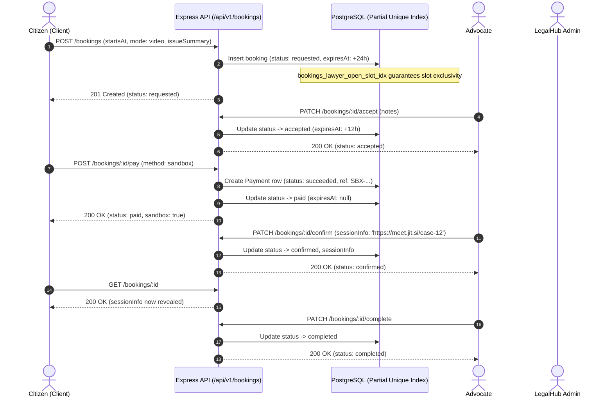

# Part G — Upgraded Booking Lifecycle, FSM, Simulated Payments & Event Audits

## 1. Concepts in Plain English & Real-World Pakistani Analogy

### Real-Life Pakistani Analogy: The High Court Chamber Consultation
In Pakistan, when hiring an advocate at the High Court Bench in Multan or Lahore, a client does not simply show up and hand over a bundle of cash on a handshake:
1. **The Briefing Request (`requested`):** The citizen approaches the advocate's chamber or office with a summary of their case (e.g. a property partition suit or tax audit notice). The advocate's Munshi (chamber clerk) takes note of the case nature and client contact.
2. **Reviewing the Cause-List (`accepted` / `declined`):** The advocate reviews the cause-list. If the advocate has a conflicting hearing before the Division Bench, they decline with a clear cause-list explanation (`declined`). If free, they accept the briefing request (`accepted`) and grant a 12-hour reservation window.
3. **The Token / Retainer (`paid`):** To secure the advocate's dedicated attention and lock the chamber calendar, the client deposits the consultation fee via a sandbox/token transfer (`paid`).
4. **Chamber Address & Video Link (`confirmed`):** Once payment is registered, the Munshi releases the confidential chamber address or encrypted video meeting link (`sessionInfo`). Until confirmed, this sensitive info remains strictly hidden from public and non-confirmed clients.
5. **Briefing Session (`completed`):** At the scheduled hour, the consultation occurs, advice is rendered, and the appointment is marked complete.
6. **Integrity & Refund Safeguard (`cancelled` / `refunded`):** If an unexpected strike or emergency occurs before the hearing, the booking is cancelled and fees are returned (`refunded`).

---

## 2. Technical Definitions

| Term | Technical Meaning |
|---|---|
| **Finite State Machine (FSM)** | A computational model consisting of predefined states (`requested`, `accepted`, `paid`, `confirmed`, `completed`, `declined`, `cancelled`, `refunded`, `expired`). Transitions occur only along verified legal edges; illegal transitions yield an instant `409 Conflict`. |
| **Partial Unique Index** | A PostgreSQL database constraint (`bookings_lawyer_open_slot_idx`) enforcing uniqueness on `(lawyerId, startsAt)` exclusively where `status IN ('requested', 'accepted', 'paid', 'confirmed', 'pending')`. Physically prohibits double-booking at the database engine level, immune to race conditions. |
| **Lazy Expiry Evaluation** | An on-demand expiry evaluation pattern (`applyLazyExpiry`) executed whenever a booking is read or mutated. Replaces resource-heavy cron daemons by checking `expiresAt < now()` in real time and writing transition events. |
| **Simulated Sandbox Payment** | A sandbox payment gateway emulator generating unique transaction references (`SBX-...`) and creating immutable `Payment` records without requiring third-party credentials in early development slices. |
| **Confidential Credential Masking** | Dynamic field masking in `getBookingById` ensuring `sessionInfo` (Zoom link or private chamber door instructions) is returned as `null` to clients until the advocate confirms the appointment. |
| **Immutable Audit Trail (`booking_events`)** | An append-only audit ledger recording every lifecycle transition with `fromStatus`, `toStatus`, `actorId`, and explanatory notes. |

---

## 3. End-to-End Request Trace: Citizen Booking to Completion



---

## 4. Hands-On Exercises for FYP Students

### Exercise 1: Simulate the Lazy Expiry Transition
1. In PostgreSQL, update a `requested` booking's `expiresAt` column to a timestamp 2 hours in the past:
   ```sql
   UPDATE bookings SET "expiresAt" = NOW() - INTERVAL '2 hours' WHERE id = 'YOUR_BOOKING_UUID';
   ```
2. Send `GET /api/v1/bookings/YOUR_BOOKING_UUID` with the client's JWT token.
3. Observe that the returned status is now `expired`.
4. Inspect the `booking_events` table and observe that an audit event was automatically written:
   ```sql
   SELECT * FROM booking_events WHERE "bookingId" = 'YOUR_BOOKING_UUID';
   ```

### Exercise 2: Test the PostgreSQL Partial Unique Index
1. Attempt to insert two active bookings with the exact same `(lawyerId, startsAt)` directly using `psql`:
   ```sql
   INSERT INTO bookings (id, "clientId", "lawyerId", mode, date, "startsAt", "endsAt", "startUtc", "endUtc", "durationMinutes", "feePkr", status, "createdAt", "updatedAt")
   VALUES (gen_random_uuid(), 'CLIENT_UUID', 'LAWYER_UUID', 'video', '2030-01-01', '2030-01-01 10:00:00+00', '2030-01-01 10:30:00+00', '2030-01-01 10:00:00+00', '2030-01-01 10:30:00+00', 30, 3000, 'requested', NOW(), NOW());
   ```
2. Run the identical insert again. Observe PostgreSQL throw `23505: duplicate key value violates unique constraint "bookings_lawyer_open_slot_idx"`.

### Exercise 3: Trigger an Automatic Refund via Client Cancellation
1. Book an appointment, accept it as an advocate, and pay via `POST /api/v1/bookings/:id/pay`.
2. Cancel the appointment via `PATCH /api/v1/bookings/:id/cancel` with reason `"Sudden domestic travel emergency"`.
3. Check `SELECT * FROM payments WHERE "bookingId" = 'YOUR_BOOKING_UUID';` and verify that the payment status transitioned from `succeeded` to `refunded`.

---

## 5. Viva Questions & Model Answers

### Q1: Why use a Partial Unique Index instead of just checking availability with application-level code?
**Model Answer:** Application-level checks (`SELECT ... WHERE start < end`) are prone to race conditions under concurrent requests (TOCTOU: Time-of-Check to Time-of-Use). If two clients click "Book" simultaneously within milliseconds, both read zero conflicts and both insert. A PostgreSQL partial unique index (`WHERE status IN ('requested', 'accepted', 'paid', 'confirmed')`) enforces atomic exclusivity at the storage engine level, making double-booking physically impossible even across clustered Node.js instances.

### Q2: What is lazy expiry and why is it preferred over a background node-cron worker in this architecture?
**Model Answer:** A recurring cron daemon consumes memory, holds continuous database connections, and creates polling overhead even when no users are active. Lazy expiry evaluates `expiresAt < now()` reactively whenever a booking is read or mutated (`applyLazyExpiry`). For users, the state transition is instantaneous and guaranteed, while completely eliminating background worker process maintenance and thread leaks.

### Q3: Why is `sessionInfo` masked in `getBookingById` until the booking is confirmed?
**Model Answer:** `sessionInfo` may contain private chamber entry instructions, phone numbers, or private video conference room URLs. Exposing these to a client before the advocate confirms or while payment is pending presents a security and privacy risk. Masking protects advocate privacy and prevents unconfirmed litigants from entering active consultation channels.

### Q4: How does LegalHub enforce Bar Council Rule 135 compliance during the booking and payment flow?
**Model Answer:** Under Rule 135 of the Legal Practitioners and Bar Councils Rules 1976, Pakistani advocates cannot engage in commercial advertising or solicitation. LegalHub does not charge commissions on advocate fees, does not sell "Featured Advocate" placement, and does not alter search or booking priority based on payment amount. The fee belongs entirely to the advocate's declared rate card.

### Q5: What happens if an admin issues a refund for a consultation?
**Model Answer:** The admin invokes `PATCH /api/v1/admin/bookings/:id/refund` with a mandatory reason (minimum 10 characters). The booking status transitions to `refunded`, any associated `Payment` record transitions to `refunded`, and an immutable record is appended to `booking_events` with the admin's UUID as `actorId`.

---

## 6. Common Pitfalls & Mistakes

1. **Locking Outer-Joined Tables (`FOR UPDATE`):**
   * *Mistake:* Using `include: [{ model: Payment }]` alongside `lock: t.LOCK.UPDATE`.
   * *Consequence:* PostgreSQL throws `ERROR: FOR UPDATE cannot be applied to the nullable side of an outer join`.
   * *Correction:* Acquire the pessimistic row lock on the primary entity (`Booking`), then query child entities (`Payment`) in subsequent transactional queries.
2. **Hardcoding Simulated Payment Gateways:**
   * *Mistake:* Storing fake credit card numbers or mock Stripe tokens in production code.
   * *Correction:* Use a clean sandbox protocol (`method: 'sandbox'`) with dynamic UUID/alphanumeric reference generators (`SBX-...`).
3. **Allowing Premature Completion:**
   * *Mistake:* Allowing advocates to mark consultations as completed before the scheduled start time.
   * *Correction:* Validate that `startsAt <= now()` before allowing transition from `confirmed` to `completed`.
