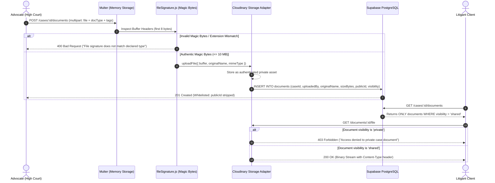

# FYP Student Learning Guide: Phase 3 Part J — Case Documents & Private Asset Storage

**Project:** LegalHub Backend (FYP — Emerson University Multan)  
**Authors:** Final-Year Undergraduate Students (Syed Asad, Muhammad Aqeel, Mubashir Mehmood)  
**Domain:** Court Documents, Magic Bytes Verification, Private Cloudinary Storage, Whitelist Projections

---

## 1. Plain-English Concept & Relatable Pakistani Analogy

### Real-Life Pakistani Analogy: The Advocate's Steel Safe (*Tijori*) in Multan Kutchery
In a traditional Pakistani legal chamber at Multan Kutchery, an Advocate High Court maintains a locked steel safe (*Tijori*). Inside that safe, the advocate keeps the case file (*Misl*).

In that file, there are two types of documents:
1. **Public/Shared Documents (*Musaddiqa Naqul* / Shared Copies):** Certified copies of court stay orders (*Hukam-e-Imtinaee*), registered sale deeds (*Bayanama*), and formal petitions (*Arzi Dawa*). The advocate freely shares photocopies of these with the client (*Muwakkil*) so the client knows what was presented to the civil judge.
2. **Private Chamber Work-Product (*Makhfi Dastawizat*):** The advocate's personal handwritten cross-examination notes, strategy outlines, confidential forensic drafts, and unredacted witness interviews. If the client or an opposing counsel walks into the chamber, they are strictly forbidden from seeing or touching these papers.

Furthermore, when a clerk brings a document claiming it is a genuine stamp paper (*Asal Ashtam*), the advocate does not merely look at the label on the envelope. The advocate holds the paper up to the sunlight to inspect the **watermark and treasury embossing** to verify that someone did not just print a fake text on plain paper.

### How This Maps to Software Engineering in LegalHub
* **The Watermark Check $\rightarrow$ Magic Bytes Inspection (`fileSignature.js`):**  
  An attacker might take a malicious `.exe` file and rename it to `order.pdf`. A basic server that only checks the file extension `.pdf` or the client-declared `Content-Type` header will be tricked. LegalHub inspects the actual binary header bytes in memory: a genuine PDF MUST begin with `%PDF-` (`0x25, 0x50, 0x44, 0x46, 0x2D`), a JPEG MUST begin with `0xFF, 0xD8, 0xFF`, and a DOCX MUST begin with `PK\x03\x04`.
* **The Steel Safe $\rightarrow$ Cloudinary Authenticated Private Assets:**  
  Unlike e-commerce product photos which have public URLs like `https://res.cloudinary.com/.../shirt.jpg`, confidential court evidence can NEVER be accessible via a public URL. In LegalHub, files are uploaded with `type: 'authenticated'`. The browser or client is NEVER given a Cloudinary URL.
* **The Chamber Clerk $\rightarrow$ Streaming Proxy Endpoint (`GET /api/v1/documents/:id/file`):**  
  All document access passes through LegalHub's Express server. The controller verifies whether the requester is the assigned advocate or a linked client authorized to view that specific document. Only then does the backend fetch the binary stream from private storage and pipe it directly into `res`.
* **The Whitelist Projection (`projectDocument`):**  
  Even in metadata responses (`GET /cases/:id/documents`), the database columns `publicId` and `resourceType` are stripped out. The frontend only receives clean business fields (`id`, `originalName`, `mimeType`, `sizeBytes`, `docType`, `tags`, `visibility`).

---

## 2. Technical Architecture & File Flow



---

## 3. Practical Hands-On Exercises for FYP Students

### Exercise 1: Bypass the File Extension Deception
* **Objective:** Prove that client-provided file extensions and MIME headers cannot be trusted.
* **Task:** Create a plain text file on your terminal named `deceptive.pdf` containing the string `"Hello World"`.
* **Action:** Send a `POST` request to `/api/v1/cases/:id/documents` attaching this file with `docType: 'Petition'`.
* **Expected Result:** Supertest or Thunder Client will receive a `400 Bad Request` with message: `"Unsupported file format or invalid file signature. Allowed: PDF, JPEG, PNG, DOC, DOCX"`.
* **Learning Takeaway:** Never trust `req.file.originalname` or `req.file.mimetype`. Always inspect the buffer's initial byte sequence (Magic Bytes).

### Exercise 2: Verify the Admin Privacy Barrier
* **Objective:** Verify that system administrators cannot snoop on confidential case documents.
* **Task:** Generate a JWT token for the platform administrator (`role: 'admin'`).
* **Action:** Make a `GET` request to `/api/v1/cases/:id/documents` and `/api/v1/documents/:id/file` using the administrator token.
* **Expected Result:** The server responds with `403 Forbidden` (`"Forbidden: Administrators have no access to confidential case documents"`).
* **Learning Takeaway:** In legal software under Pakistani law (Rule 135 and the Qanun-e-Shahadat Order 1984), attorney-client privilege prohibits even server operators from viewing case evidence without explicit judicial subpoena.

### Exercise 3: Test Whitelist Projection Leaks
* **Objective:** Ensure no internal Cloudinary identifiers are exposed to frontend clients.
* **Task:** Call `GET /api/v1/cases/:id/documents` as a linked client and inspect the JSON keys in the returned objects.
* **Action:** Verify that `publicId` and `resourceType` are `undefined`.
* **Learning Takeaway:** Whitelist projection ensures internal cloud architecture details remain completely hidden from end users.

---

## 4. Viva Voce Questions & Model Answers

### Q1: Why did you use magic bytes validation instead of relying on `req.file.mimetype`?
**Answer:**  
`req.file.mimetype` and `req.file.originalname` are supplied by the client's browser in the multipart request header (`Content-Disposition: form-data; name="file"; filename="order.pdf"; Content-Type: application/pdf`). Any malicious user can use `curl` or Postman to upload an executable script (`malware.exe`) and set the header to `application/pdf`. Magic bytes validation inspects the first several bytes of the raw binary buffer in server memory. For example, genuine PDF files always start with `%PDF-` (`0x25, 0x50, 0x44, 0x46, 0x2D`). If the bytes do not match the declared extension, our server rejects the request with HTTP 400 before saving anything to disk or cloud storage.

### Q2: Why are case documents stored as "authenticated" private assets instead of public cloud URLs?
**Answer:**  
In conventional websites, media files are stored publicly on a CDN so browsers can fetch them directly. However, court documents contain sensitive national identity cards, bank statements, certified judgments, and family dispute records. If public URLs were generated, anyone who obtained the URL hash could view confidential litigant records. By using Cloudinary's `type: 'authenticated'` mode, direct public web access is completely disabled. All downloads must pass through our backend endpoint `GET /api/v1/documents/:id/file`, where our authorization middleware verifies that the user is either the assigned advocate or a linked client authorized to view that specific shared document.

### Q3: Why does LegalHub buffer files in memory (`multer.memoryStorage()`) rather than saving them to a temporary server directory?
**Answer:**  
Saving files to the local disk in a multi-tenant cloud environment introduces file system pollution, disk space exhaustion risks, and local file inclusion vulnerabilities. By using `multer.memoryStorage()`, the uploaded file is held in a Node.js `Buffer` in RAM. We immediately inspect its magic bytes, check that its size does not exceed 10 MB, pipe it directly to cloud storage, and let Node.js garbage collection release the memory buffer immediately after the HTTP request completes.

### Q4: How does LegalHub enforce privilege isolation between the advocate and the litigant client?
**Answer:**  
Every document has a `visibility` attribute (`'private'` or `'shared'`). When an advocate queries the case documents (`GET /cases/:id/documents`), the database returns all documents. But when a linked client queries the endpoint, our service layer overrides any query filter and strictly appends `WHERE visibility = 'shared'`. Furthermore, if a client discovers the UUID of a private document and attempts to call `GET /documents/:id/file`, the service checks the document's visibility; if it is `'private'`, it throws an HTTP 403 Forbidden error (`"Access denied to private case document"`).

### Q5: How did you implement automated tests for file uploads without making live network calls to Cloudinary?
**Answer:**  
We engineered a mockable Storage Adapter pattern in `backend/src/services/storage/cloudinaryStorage.js`. When running in the test environment (`process.env.NODE_ENV === 'test'`), the adapter stores the uploaded binary buffers in an in-memory `Map` data structure. When the file streaming endpoint is called, it returns `stream.Readable.from(item.buffer)`. This allows our Jest test suite to execute 23 integration tests—including oversized files, magic byte manipulations, and streaming verifications—in sub-seconds completely offline without needing live Cloudinary API keys or incurring external bandwidth costs.

---

## 5. Thunder Client / Postman Testing Script

```json
{
  "clientName": "Thunder Client",
  "collectionName": "LegalHub - Phase 3 Part J (Case Documents)",
  "requests": [
    {
      "name": "1. Upload Valid PDF Document (Advocate)",
      "method": "POST",
      "url": "http://localhost:4000/api/v1/cases/{{CASE_ID}}/documents",
      "headers": {
        "Authorization": "Bearer {{LAWYER_TOKEN}}"
      },
      "body": {
        "type": "form-data",
        "form-data": [
          { "key": "file", "type": "file", "value": "sample_petition.pdf" },
          { "key": "docType", "value": "Petition" },
          { "key": "visibility", "value": "private" },
          { "key": "tags", "value": "[\"writ\", \"high_court\"]" }
        ]
      }
    },
    {
      "name": "2. Upload Shared Court Order (Advocate)",
      "method": "POST",
      "url": "http://localhost:4000/api/v1/cases/{{CASE_ID}}/documents",
      "headers": {
        "Authorization": "Bearer {{LAWYER_TOKEN}}"
      },
      "body": {
        "type": "form-data",
        "form-data": [
          { "key": "file", "type": "file", "value": "court_stay_order.pdf" },
          { "key": "docType", "value": "Court Order" },
          { "key": "visibility", "value": "shared" },
          { "key": "tags", "value": "[\"stay_order\", \"injunction\"]" }
        ]
      }
    },
    {
      "name": "3. List Documents (Advocate - Sees All)",
      "method": "GET",
      "url": "http://localhost:4000/api/v1/cases/{{CASE_ID}}/documents",
      "headers": {
        "Authorization": "Bearer {{LAWYER_TOKEN}}"
      }
    },
    {
      "name": "4. List Documents (Client - Sees Shared Only)",
      "method": "GET",
      "url": "http://localhost:4000/api/v1/cases/{{CASE_ID}}/documents",
      "headers": {
        "Authorization": "Bearer {{CLIENT_TOKEN}}"
      }
    },
    {
      "name": "5. Update Document Visibility to Shared (Advocate)",
      "method": "PATCH",
      "url": "http://localhost:4000/api/v1/documents/{{DOCUMENT_ID}}",
      "headers": {
        "Authorization": "Bearer {{LAWYER_TOKEN}}",
        "Content-Type": "application/json"
      },
      "body": {
        "raw": "{\n  \"visibility\": \"shared\",\n  \"tags\": [\"verified\", \"shared_copy\"]\n}"
      }
    },
    {
      "name": "6. Download Document Stream (Client - Shared OK)",
      "method": "GET",
      "url": "http://localhost:4000/api/v1/documents/{{DOCUMENT_ID}}/file",
      "headers": {
        "Authorization": "Bearer {{CLIENT_TOKEN}}"
      }
    },
    {
      "name": "7. Admin Attempt to List Documents (Expect 403)",
      "method": "GET",
      "url": "http://localhost:4000/api/v1/cases/{{CASE_ID}}/documents",
      "headers": {
        "Authorization": "Bearer {{ADMIN_TOKEN}}"
      }
    }
  ]
}
```
