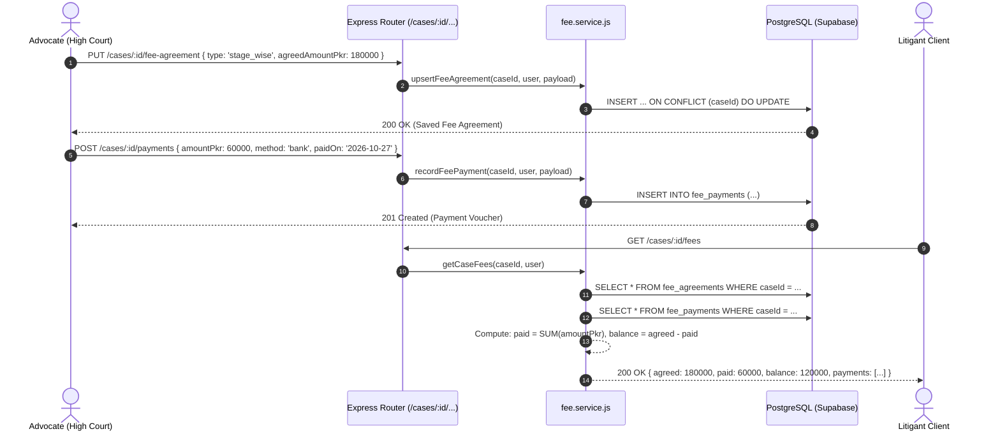

# FYP Student Learning Guide: Phase 3 Part K — Case Fees & Payment Ledger

**Project:** LegalHub Backend (FYP — Emerson University Multan)  
**Authors:** Final-Year Undergraduate Students (Syed Asad, Muhammad Aqeel, Mubashir Mehmood)  
**Domain:** Case Fees, Fee Agreements, Payment Records, Dynamic Balances, Rule 135 Compliance

---

## 1. Plain-English Concept & Relatable Pakistani Analogy

### Real-Life Pakistani Analogy: The Advocate’s Munshi Ledger (*Khata-Register*) in Multan Kutchery
In a traditional Pakistani legal chamber at Multan Kutchery, when a client (*Muwakkil*) engages an advocate for a civil suit, land dispute, or criminal appeal, the advocate and client sit across the desk to agree on a fee (*Muawaza / Fee Taiba*):
* **Fixed Lump-Sum (*Mukammal Muawaza*):** A single total amount (e.g., Rs. 150,000 for the entire trial).
* **Per-Appearance (*Fi-Peshie*):** An agreed rate every time the advocate appears before the Civil Judge or Sessions Court (e.g., Rs. 5,000 per hearing).
* **Stage-wise (*Marhala-war*):** Agreed milestones (e.g., Rs. 50,000 upon filing pleadings, Rs. 50,000 upon framing of issues, and Rs. 50,000 during final arguments).

Whenever the client brings money—whether cash paid in the chamber, a bank IBFT transfer, a crossed cheque, or a mobile payment via JazzCash or EasyPaisa—the advocate’s clerk (*Munshi*) writes the payment into the case ledger (*Khatooni*): the date, the payment method, transaction/cheque reference, and amount.

At any given point, both the advocate and the client can view this running ledger:
1. **Total Agreed Amount (*Kul Tay-Shuda Raqam*):** The contractual fee.
2. **Paid to Date (*Wasool Shuda Raqam*):** Sum of all recorded payments.
3. **Balance (*Baqaya Raqam*):** `Agreed Amount - Paid to Date`. If the client gave an advance deposit greater than the agreed stage, the balance accurately shows as negative (e.g., `-Rs. 10,000`), representing client credit.

There are no complex corporate installment schedules, automated late penalties, or deletion of receipts—it is a clean, honest, transparent running ledger between advocate and litigant.

### How This Maps to Software Engineering in LegalHub
* **The Agreement Form $\rightarrow$ `PUT /cases/:id/fee-agreement`:**  
  A single case file has at most one active representation fee agreement (`caseId` is unique). An "upsert" operation creates the contract if it does not exist, or updates its terms if already recorded.
* **The Cash/Bank Voucher $\rightarrow$ `POST /cases/:id/payments`:**  
  Each payment entry captures the amount, payment method (`cash`, `bank`, `jazzcash`, `easypaisa`, `cheque`), optional transaction reference, date paid, and note.
* **The Dynamic Ledger $\rightarrow$ `GET /cases/:id/fees`:**  
  The balance is never stored statically in the database. Instead, the backend computes `paid = SUM(amountPkr)` dynamically and derives `balance = agreed - paid`. Even if the client pays an advance exceeding the agreed amount, the negative balance is displayed as-is without artificially clamping to zero.
* **The Financial Privacy Barrier:**  
  Under Pakistani legal privilege and business privacy, platform administrators have zero right to inspect private chamber fees. Calling `GET /cases/:id/fees` as an administrator strictly returns `403 Forbidden`.

---

## 2. Technical Architecture & File Flow



---

## 3. Practical Hands-On Exercises for FYP Students

### Exercise 1: Verify Negative Balance Calculation
* **Objective:** Verify that client overpayment or advance deposits accurately reflect negative balance without artificial zero-clamping.
* **Task:** Create a fee agreement with `agreedAmountPkr: 100000`. Record two payments: one for `70000` and one for `50000` (total paid = `120000`).
* **Action:** Send a `GET` request to `/api/v1/cases/:id/fees`.
* **Expected Result:** `agreed: 100000`, `paid: 120000`, and `balance: -20000`.
* **Learning Takeaway:** Never store computed balances in database columns where they can get out of sync with payment ledger rows. Always compute them dynamically.

### Exercise 2: Test the Financial Privacy Barrier
* **Objective:** Prove that platform administrators cannot snoop on chamber financial terms.
* **Task:** Generate an admin JWT token (`role: 'admin'`).
* **Action:** Attempt to call `GET /api/v1/cases/:id/fees`, `PUT /api/v1/cases/:id/fee-agreement`, and `POST /api/v1/cases/:id/payments`.
* **Expected Result:** All three requests return `403 Forbidden` (`"Forbidden: Administrators have no access to confidential case fee records"`).
* **Learning Takeaway:** In legaltech systems, RBAC must treat system administrators as zero-trust operators regarding client-attorney privileged financials.

### Exercise 3: Test Payment Validation Boundaries
* **Objective:** Ensure boundary conditions prevent corrupt financial entries.
* **Task:** Attempt to record a payment with `amountPkr: 0` and an invalid date `paidOn: "27-10-2026"`.
* **Action:** Send `POST /api/v1/cases/:id/payments`.
* **Expected Result:** The server rejects the request with `400 Bad Request` and detailed Zod validation errors.
* **Learning Takeaway:** Strict schema validation at the gateway level prevents data corruption before queries reach the database.

---

## 4. Viva Voce Questions & Model Answers

### Q1: Why did you use an upsert (`PUT`) for fee agreements instead of separate `POST` and `PATCH` endpoints?
**Answer:**  
In legal practice, a case has exactly one contractual fee agreement between the advocate and client at any given time (`caseId` has a unique constraint in `fee_agreements`). Modeling this as an upsert (`PUT /cases/:id/fee-agreement`) makes the endpoint idempotent. If no agreement exists yet, the server creates it; if terms are modified later (e.g., renegotiated stage fees), the server updates the existing record seamlessly without requiring frontend clients to track whether a contract ID already exists.

### Q2: Why did you choose NOT to implement automated installment schedules, due dates, or invoices?
**Answer:**  
Under Rule 135 of the Legal Practitioners and Bar Councils Rules 1976 and prevailing Pakistani court culture, legal advocacy is a noble profession (*Pesh-e-Wakalat*), not a commercial retail enterprise. Corporate billing features such as automated installment penalties, due date dunning, and formal tax invoices are neither legally appropriate nor culturally reflective of Pakistani litigation chambers, where payments are remitted informally based on hearing stages or mutual trust. Keeping the ledger strictly to agreed terms, payment vouchers, and running balance preserves simplicity and regulatory compliance.

### Q3: Why is `balance` computed on the fly instead of being stored as a column in `cases` or `fee_agreements`?
**Answer:**  
Storing `balance` or `totalPaid` as a database column introduces data redundancy and cache invalidation anomalies. If a payment record were edited or a database transaction failed midway, the stored balance would diverge from the actual sum of payment rows. By querying `FeePayment.findAll()` and computing `paid = sum(amountPkr)` dynamically, the ledger guarantees 100% mathematical consistency without requiring complex database triggers or distributed transactions.

### Q4: How are different payment channels (Cash, Bank, JazzCash, EasyPaisa, Cheque) validated?
**Answer:**  
We defined a strict enum `FEE_PAYMENT_METHODS: ['cash', 'bank', 'jazzcash', 'easypaisa', 'cheque']` in `src/constants/case.js` and enforced it via both Zod schema validation and Sequelize model constraints. Optional reference numbers (such as cheque leaf numbers or mobile transaction IDs) are validated for a maximum length of 60 characters, and payment dates must conform to the ISO `YYYY-MM-DD` date pattern.

### Q5: How did you verify the 6-role permission matrix for fee records in automated tests?
**Answer:**  
In `backend/tests/fee.test.js`, we evaluated all six system roles:
1. **Assigned Advocate:** Full read and write access (`200 OK` / `201 Created`).
2. **Linked Client:** Read-only access to their case fee ledger (`200 OK`), but forbidden from setting agreements or recording payments (`403 Forbidden`).
3. **Another Advocate:** Completely forbidden (`403 Forbidden`).
4. **Unlinked Client:** Completely forbidden (`403 Forbidden`).
5. **Platform Administrator:** Completely forbidden (`403 Forbidden`).
6. **Unauthenticated User:** Rejected with `401 Unauthorized`.

---

## 5. Thunder Client / Postman Testing Script

```json
{
  "clientName": "Thunder Client",
  "collectionName": "LegalHub - Phase 3 Part K (Case Fees)",
  "requests": [
    {
      "name": "1. Set Fee Agreement (Advocate)",
      "method": "PUT",
      "url": "http://localhost:4000/api/v1/cases/{{CASE_ID}}/fee-agreement",
      "headers": {
        "Authorization": "Bearer {{LAWYER_TOKEN}}",
        "Content-Type": "application/json"
      },
      "body": {
        "raw": "{\n  \"type\": \"stage_wise\",\n  \"agreedAmountPkr\": 180000,\n  \"notes\": \"Rs. 60k pleadings, Rs. 60k evidence, Rs. 60k arguments\"\n}"
      }
    },
    {
      "name": "2. Record Bank Payment (Advocate)",
      "method": "POST",
      "url": "http://localhost:4000/api/v1/cases/{{CASE_ID}}/payments",
      "headers": {
        "Authorization": "Bearer {{LAWYER_TOKEN}}",
        "Content-Type": "application/json"
      },
      "body": {
        "raw": "{\n  \"amountPkr\": 60000,\n  \"method\": \"bank\",\n  \"reference\": \"HBL-IBFT-99881122\",\n  \"paidOn\": \"2026-10-27\",\n  \"note\": \"Initial stage fee received\"\n}"
      }
    },
    {
      "name": "3. Record JazzCash Payment (Advocate)",
      "method": "POST",
      "url": "http://localhost:4000/api/v1/cases/{{CASE_ID}}/payments",
      "headers": {
        "Authorization": "Bearer {{LAWYER_TOKEN}}",
        "Content-Type": "application/json"
      },
      "body": {
        "raw": "{\n  \"amountPkr\": 20000,\n  \"method\": \"jazzcash\",\n  \"reference\": \"JC-445566\",\n  \"paidOn\": \"2026-10-27\"\n}"
      }
    },
    {
      "name": "4. Get Fee Ledger (Advocate)",
      "method": "GET",
      "url": "http://localhost:4000/api/v1/cases/{{CASE_ID}}/fees",
      "headers": {
        "Authorization": "Bearer {{LAWYER_TOKEN}}"
      }
    },
    {
      "name": "5. Get Fee Ledger (Linked Client)",
      "method": "GET",
      "url": "http://localhost:4000/api/v1/cases/{{CASE_ID}}/fees",
      "headers": {
        "Authorization": "Bearer {{CLIENT_TOKEN}}"
      }
    },
    {
      "name": "6. Admin Attempt to View Fees (Expect 403)",
      "method": "GET",
      "url": "http://localhost:4000/api/v1/cases/{{CASE_ID}}/fees",
      "headers": {
        "Authorization": "Bearer {{ADMIN_TOKEN}}"
      }
    }
  ]
}
```
