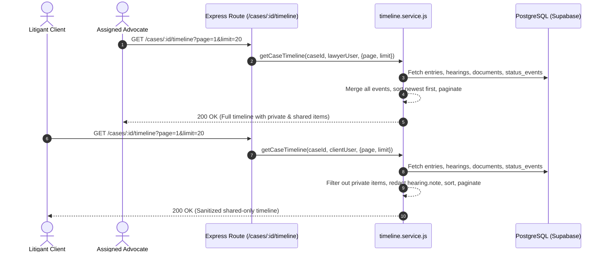

# FYP Student Learning Guide: Phase 3 Part L — Case Timeline & Client View

**Project:** LegalHub Backend (FYP — Emerson University Multan)  
**Authors:** Final-Year Undergraduate Students (Syed Asad, Muhammad Aqeel, Mubashir Mehmood)  
**Domain:** Polymorphic Timeline Aggregation, Role-Based Event Filtering, Privileged Chamber Note Redaction, Client Projection

---

## 1. Plain-English Concept & Relatable Pakistani Analogy

### Real-Life Pakistani Analogy: The Litigant's Progress Folder & Cause-Board (*Muwakkil ki Mukammal Misal o Tareekh-e-Peshie*)
In the legal chambers of Multan Kutchery, an advocate maintains a comprehensive case file (*Misal*). Inside this file, multiple types of papers accumulate over time:
1. **Peshie / Hearing Records:** Dates when the case was called before the Civil Judge or High Court Bench, the stage reached, the court's interim order, and the next date given.
2. **Diary Notes (*Roznamcha*):** Entries recording chamber conferences, bail submissions, or notices served.
3. **Court Documents (*Dastawezat*):** Plaints (*Arzi Dawa*), written statements (*Jawab Dawa*), certified copies of revenue records (*Fard / Jamabandi*), and vakalatnamas.
4. **Milestone Events (*Halat-e-Muqaddama*):** Formal shifts in case status—such as transitioning from "Active" to "Stay Granted" or "Decided".

When the client (*Muwakkil*) visits the chamber or asks for a progress report, they want to see a single chronological history of their case from day one to the present.

However, legal ethics and chamber privilege impose a strict barrier:
* **Chamber Work-Product (*Zaati / Mahfooz Notes*):** In his personal diary or hearing record, the advocate might write: *"The Judge seemed skeptical about witness B; need to prepare alternative revenue patwari testimony for cross-examination."* This is private legal strategy. If the client or opposing party reads this, it could cause panic, confusion, or compromise the legal defense.
* **Client Explanation (*Muwakkil ko Wazahat*):** Instead, the advocate tells the client: *"Arguments heard in part; adjourned for cross-examination of revenue record officer on 15th November."*
* **Chamber Research vs. Client Documents:** An internal draft petition is kept private until finalized, while the officially submitted plaint and stay order are shared with the client.

LegalHub's Part L translates this exact professional chamber workflow into secure, role-aware software engineering.

---

## 2. Technical Architecture & Unified Timeline Model

Instead of forcing frontend clients to make 4 separate API calls to stitch together a case history, LegalHub provides a single aggregated timeline endpoint:
`GET /api/v1/cases/:id/timeline`

### Polymorphic Event Normalization
The service queries 4 heterogeneous PostgreSQL tables and normalizes each record into a unified event structure:

```json
{
  "kind": "entry | hearing | document | status_event",
  "date": "2026-10-27T06:00:00.000Z",
  "title": "Short title describing the event",
  "summary": "Contextual description or client explanation",
  "visibility": "shared | private",
  "refId": "uuid-of-the-underlying-record"
}
```

### Role-Based Filter & Redaction Rules

| Event Kind | Source Table | Lawyer View | Client View | Privacy Enforcement |
| :--- | :--- | :--- | :--- | :--- |
| `status_event` | `case_status_events` | Visible (`visibility: 'shared'`) | Visible (`visibility: 'shared'`) | Formal case status transitions are always public to the litigant. |
| `entry` | `case_entries` | All entries (`shared` and `private`) | Shared entries only (`visibility: 'shared'`) | Private diary entries remain strictly in the lawyer's chamber view. |
| `document` | `documents` | All documents (`shared` and `private`) | Shared documents only (`visibility: 'shared'`) | Internal drafts or chamber research files are excluded from client view. |
| `hearing` | `hearings` | Full record (includes chamber `note`) | Sanitized record (includes `clientExplanation`; `note` is **completely omitted**) | Private chamber note is redacted. `summary` uses `clientExplanation` if available, otherwise `outcome`. |



---

## 3. Practical Hands-On Exercises for FYP Students

### Exercise 1: Verify Privileged Hearing Note Leak Barrier
* **Objective:** Prove that an advocate's confidential chamber notes never reach the litigant over the network.
* **Task:**
  1. As an advocate, record a hearing with:
     - `outcome: "Arguments concluded"`
     - `note: "Private Chamber Note: Judge may dismiss unless precedent cited"`
     - `clientExplanation: "Arguments completed, awaiting order"`
  2. As the linked client, call `GET /api/v1/cases/:id/timeline`.
* **Verification:** Inspect the hearing item in the client timeline. Verify that:
  - `note` is NOT a property of the JSON object (`expect(item.note).toBeUndefined()`).
  - `summary` equals `"Arguments completed, awaiting order"`.
  - The text `"Private Chamber Note"` does not appear anywhere in the entire response body.

### Exercise 2: Test Single Case Client Projection & Document Counting
* **Objective:** Ensure `GET /cases/:id` accurately reports `sharedDocumentsCount` without leaking confidential counts.
* **Task:**
  1. Upload 3 documents to a case: 2 with `visibility: 'shared'` and 1 with `visibility: 'private'`.
  2. As the linked client, call `GET /cases/:id`.
* **Verification:**
  - Verify that `data.sharedDocumentsCount === 2`.
  - Verify that sensitive fields (`lawyerId`, `clientId`, `bookingId`, `statusEvents`) are omitted from the client response.

### Exercise 3: Verify Timeline Chronological Sorting Across Heterogeneous Sources
* **Objective:** Verify that events from four different tables sort accurately by timestamp regardless of insertion order.
* **Task:** Create a case entry dated 2 days ago, a hearing scheduled for tomorrow, a document uploaded yesterday, and a status event from today.
* **Verification:** Call `GET /api/v1/cases/:id/timeline`. Confirm that the array elements appear strictly sorted in descending chronological order (`events[0].date >= events[1].date`).

---

## 4. Viva Voce Questions & Model Answers

### Q1: Why did you aggregate the timeline in application logic rather than writing a complex SQL `UNION` query?
**Answer:**  
The four underlying tables (`case_entries`, `hearings`, `documents`, `case_status_events`) have completely different schemas, data types, and filtering requirements. Performing a SQL `UNION` would require extensive database casting, `NULL` padding across columns, and would make role-based conditional sanitation (such as falling back from `clientExplanation` to `outcome` for hearings) fragile and database-vendor dependent. Performing the normalization and sorting in `timeline.service.js` keeps business rules clean, maintainable, and easily unit-testable.

### Q2: What is the security purpose of the `sharedDocumentsCount` field on `GET /cases/:id`?
**Answer:**  
Litigants need to know how many official documents are available for download in their case folder. If we returned the total document count (including private chamber research drafts), a litigant could notice a discrepancy between the document count and the files they can see, causing confusion or mistrust. Returning `sharedDocumentsCount` guarantees that the client view is consistent with their actual download permissions.

### Q3: Why are `case_status_events` always treated as `shared` on the timeline?
**Answer:**  
In Pakistani civil and criminal procedure, formal case milestones (e.g., Filing, Notice Issued, Adjourned, Stay Granted, Disposed) are official court records. A client has an absolute legal and ethical right to know the formal status and procedural stage of their litigation. Therefore, status transitions are inherently transparent and always visible to the linked client.

### Q4: How does pagination work across four different database tables?
**Answer:**  
In `timeline.service.js`, the service fetches the relevant records for the case, merges and sorts the complete array in memory, and slices the array based on `page` and `limit` query parameters (`startIndex = (page - 1) * limit`). Because a single case typically has dozens to hundreds of active events (not millions), in-memory sorting and pagination provides sub-millisecond response times with guaranteed chronological accuracy across all event kinds.

### Q5: What error is returned if an unlinked client or another advocate attempts to access the timeline?
**Answer:**  
The endpoint enforces the strict case boundary policy:
* If the user is an advocate not assigned to the case: `403 Forbidden` (`"Forbidden: You are not the assigned advocate for this case"`).
* If the user is a client not linked to the case: `403 Forbidden` (`"Forbidden: You are not the linked client for this case"`).
* If the user is a platform administrator: `403 Forbidden` (`"Forbidden: Administrators have no access to confidential case files"`).
* If no JWT token is supplied: `401 Unauthorized`.

---

## 5. Automated / Manual Test Script (cURL & Thunder Client)

```bash
# 1. Advocate retrieves full timeline (includes private diary notes & internal documents)
curl -X GET http://localhost:4000/api/v1/cases/YOUR_CASE_ID/timeline?page=1&limit=20 \
  -H "Authorization: Bearer LAWYER_JWT_TOKEN"

# 2. Linked client retrieves sanitized timeline (shared items only, chamber notes redacted)
curl -X GET http://localhost:4000/api/v1/cases/YOUR_CASE_ID/timeline?page=1&limit=20 \
  -H "Authorization: Bearer CLIENT_JWT_TOKEN"

# 3. Client retrieves single case file with nextHearing and sharedDocumentsCount
curl -X GET http://localhost:4000/api/v1/cases/YOUR_CASE_ID \
  -H "Authorization: Bearer CLIENT_JWT_TOKEN"
```
