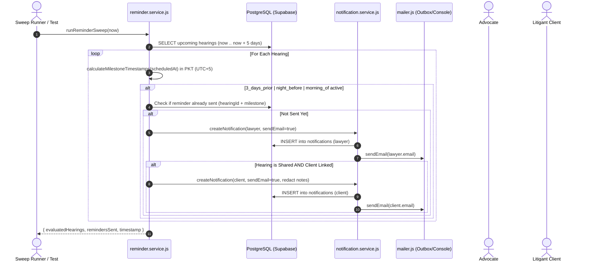

# FYP Student Learning Guide: Phase 3 Part M — Notifications, Email Delivery & Reminders

**Project:** LegalHub Backend (FYP — Emerson University Multan)  
**Authors:** Final-Year Undergraduate Students (Syed Asad, Muhammad Aqeel, Mubashir Mehmood)  
**Domain:** In-App Notifications, Zero-Dependency Mailer Adapter, Deterministic Hearing Reminder Sweeps, PKT Timezone Math, Idempotency

---

## 1. Plain-English Concept & Relatable Pakistani Analogy

### Real-Life Pakistani Analogy: The Advocate’s Senior Munshi & Court Process Server (*Munshi o Chobdar*)
In Pakistani district and high court chambers (such as Multan District Courts or Lahore High Court Multan Bench), advocates and clients cannot sit in the registry or courtroom all day waiting for announcements:
* **The Munshi's Reminder Diary (*Roznamcha-e-Yaddasht*):**  
  A seasoned advocate's clerk (*Munshi*) keeps a strict diary of upcoming court hearings (*Peshian*):
  1. **3 Days Before at 09:00 AM:** The Munshi reminds the advocate: *"Sir, the land title case before the Additional District Judge is on Thursday; we must prepare the rejoinder."*
  2. **Night Before at 08:00 PM:** The Munshi calls the client (*Muwakkil*): *"Assalam-o-Alaikum, Haji Sahib. Tomorrow at 08:30 AM sharp, meet us at Court Room No. 4 with your original CNIC."*
  3. **Morning Of at 07:00 AM:** The Munshi checks the early cause list (*Fahrist-e-Muqadmat*) to confirm the bench and serial number.
* **The Written Notice (*Ittila-nama*):**  
  When an important event happens (e.g., consultation booking confirmed, certified stay order uploaded, fee payment acknowledged), an official memo is delivered. Once the recipient reads it, they mark it as seen (*Mulaheza Shuda*).

### How This Maps to Software Engineering in LegalHub
1. **The In-App Inbox (`notifications` table):**  
   Every user has an in-app notification bell with an unread badge counter (`GET /notifications/unread-count`). They can query their notifications (`GET /notifications`), mark single items as read (`PATCH /notifications/:id/read`), or mark everything as read (`PATCH /notifications/read-all`).
2. **Zero-Dependency Mailer Module (`src/utils/mailer.js`):**  
   Adhering to our project rule to not introduce arbitrary npm packages, we implement a lightweight, pluggable email adapter:
   * `MAIL_PROVIDER=console` (default for dev): Cleanly logs recipient, subject, and body without throwing errors or requiring external network credentials.
   * `MAIL_PROVIDER=test` (for Jest integration tests): Captures outbound messages in an in-memory outbox array (`getOutbox()`, `clearOutbox()`) so automated tests can verify email delivery without sending real emails.
3. **Pure Reminder Sweep Function (`runReminderSweep(now)`):**  
   A deterministic function that evaluates scheduled court hearings against Pakistan Standard Time (`Asia/Karachi`, UTC+5) for:
   * **3 days before at 09:00 PKT**
   * **Night before at 20:00 (8:00 PM) PKT**
   * **Morning of at 07:00 (7:00 AM) PKT**  
   It generates notifications for the assigned advocate (and for the client if the hearing is `shared`), using idempotency metadata so duplicate reminders are never created.

---

## 2. Technical Architecture & File Flow



---

## 3. Practical Hands-On Exercises for FYP Students

### Exercise 1: Verify Pakistan Standard Time (PKT / UTC+5) Milestone Math
* **Objective:** Understand how UTC database timestamps map to local Pakistan court reminder hours.
* **Task:**
  1. Pick a hearing scheduled for `2026-11-15 10:00:00 PKT` (which is `2026-11-15 05:00:00 UTC`).
  2. Call `calculateMilestoneTimestamps(hearingDate)`.
* **Verification:**
  - `3_days_prior` trigger timestamp MUST be `2026-11-12T04:00:00.000Z` (09:00 AM PKT).
  - `night_before` trigger timestamp MUST be `2026-11-14T15:00:00.000Z` (08:00 PM PKT).
  - `morning_of` trigger timestamp MUST be `2026-11-15T02:00:00.000Z` (07:00 AM PKT).

### Exercise 2: Test Mailer In-Memory Test Outbox
* **Objective:** Verify email dispatch without sending real network traffic.
* **Task:**
  1. Set `NODE_ENV=test` and call `clearOutbox()`.
  2. Call `createNotification({ userId, type: 'booking_confirmed', title: 'Consultation Booked', sendEmail: true })`.
  3. Inspect `getOutbox()`.
* **Verification:** Verify that `outbox.length === 1`, recipient email matches the user, and subject matches the title.

### Exercise 3: Prove Hearing Note Confidentiality During Reminder Sweep
* **Objective:** Ensure the client notification body never leaks the advocate's private chamber strategy.
* **Task:**
  1. Create a case hearing with `note: "CONFIDENTIAL: Cross-examine defense witness on boundary survey"` and `clientExplanation: "Hearing for boundary arguments"`.
  2. Run `runReminderSweep(now)`.
  3. Inspect the notification created for the client.
* **Verification:** Verify that `clientNotification.body` does NOT contain the word `"CONFIDENTIAL"` and includes only the `clientExplanation`.

---

## 4. Viva Voce Questions & Model Answers

### Q1: Why did you implement `runReminderSweep` as a pure function accepting `now` instead of hardcoding a background `node-cron` job?
**Answer:**  
In automated unit and integration testing, relying on a real-time background cron job makes tests slow, non-deterministic, and dependent on clock sleep intervals. By writing `runReminderSweep(now = new Date())` as a pure function, we can pass mock dates (e.g. exactly 09:05 AM PKT three days prior, or 08:05 PM PKT the night before) and test all reminder paths instantaneously with 100% determinism. In production, a simple OS cron job, AWS Lambda, or Supabase Edge function can invoke this same service function periodically.

### Q2: How did you ensure reminder idempotency so users don't receive duplicate emails if the sweep runs every 10 minutes?
**Answer:**  
Each reminder notification stores structured metadata: `{ hearingId, milestone, caseId, recipientRole }`. Before dispatching, `hasReminderBeenSent(userId, hearingId, milestone)` queries whether a notification with that exact `hearingId` and `milestone` already exists for that user in the database. If it exists, the sweep skips generation, guaranteeing that a recipient receives exactly one alert per milestone.

### Q3: Why did you create an in-memory mailer instead of using third-party libraries like `nodemailer`?
**Answer:**  
Adhering to our FYP architectural rule against importing unapproved external packages, our mailer adapter uses native Node.js capabilities. It defines a clean interface (`sendEmail`, `getOutbox`, `clearOutbox`) supporting pluggable providers: `test` (in-memory queue for Jest assertions), `console` (standard development logging), and a production placeholder. This keeps the backend lightweight, secure, and completely independent of external mail service outages during development.

### Q4: What happens if a hearing has `visibility: 'private'`?
**Answer:**  
Under Pakistani civil procedure and advocate chamber practice, internal chamber review conferences and strategy meetings are privileged work-product. If a hearing has `visibility: 'private'`, `runReminderSweep` sends a reminder exclusively to the assigned advocate. The client receives zero notifications and zero emails, safeguarding legal privilege under the Qanun-e-Shahadat Order 1984.

### Q5: How do the composite indexes on the `notifications` table optimize real-world mobile app performance?
**Answer:**  
The table includes three targeted indexes:
1. `(userId, readAt)`: Accelerates `GET /notifications/unread-count` and unread filtering (`read=false`) to sub-millisecond execution.
2. `(userId, createdAt DESC)`: Optimizes paginated timeline queries (`GET /notifications?page=1&limit=20`) by allowing PostgreSQL to scan in reverse chronological order without an expensive in-memory sort.
3. `(userId, type)`: Optimizes type-specific filtering (e.g., viewing only payment vouchers or hearing reminders).

---

## 5. Automated / Manual Test Script (cURL & Thunder Client)

```bash
# 1. Fetch unread notification count (for mobile badge counter)
curl -X GET http://localhost:4000/api/v1/notifications/unread-count \
  -H "Authorization: Bearer YOUR_JWT_TOKEN"

# 2. List unread notifications (paginated)
curl -X GET "http://localhost:4000/api/v1/notifications?read=false&page=1&limit=10" \
  -H "Authorization: Bearer YOUR_JWT_TOKEN"

# 3. Mark single notification as read
curl -X PATCH http://localhost:4000/api/v1/notifications/YOUR_NOTIFICATION_UUID/read \
  -H "Authorization: Bearer YOUR_JWT_TOKEN"

# 4. Mark all notifications as read
curl -X PATCH http://localhost:4000/api/v1/notifications/read-all \
  -H "Authorization: Bearer YOUR_JWT_TOKEN"
```
