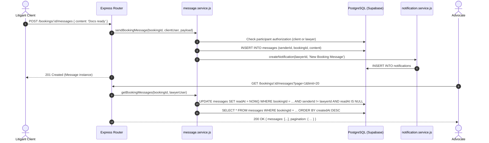

# FYP Student Learning Guide: Phase 3 Part N — Direct Messages (Booking & Case Contexts)

**Project:** LegalHub Backend (FYP — Emerson University Multan)  
**Authors:** Final-Year Undergraduate Students (Syed Asad, Muhammad Aqeel, Mubashir Mehmood)  
**Domain:** Direct Client-Advocate Messaging, Dual-Context Polymorphism (Booking vs. Case), Automatic Read Receipts, Privileged Communication Privacy

---

## 1. Plain-English Concept & Relatable Pakistani Analogy

### Real-Life Pakistani Analogy: The Advocate’s Chamber Dispatch Register & Courier (*Muraslat o Paigham-rasani*)
In a Pakistani law chamber (such as near Kutchery Chowk Multan), communication between an advocate and a citizen operates in two distinct professional settings:
1. **The Pre-Retention Consultation (Booking Context):**  
   Before a formal lawsuit is filed, a citizen schedules an appointment with an advocate to discuss a legal problem (e.g., an FIR, inheritance dispute, or contract breach). During this phase, the client sends messages clarifying their query: *"Assalam-o-Alaikum Sir, I have arranged the certified copy of the registry for our 11:00 AM meeting."* The advocate replies: *"Walaikum Assalam. Please bring your original CNIC as well."* This communication belongs strictly to the consultation appointment record.
2. **The Active Litigation File (Case Context):**  
   Once the advocate files a Vakalatnama in court, representation begins. Communication shifts to trial developments: *"The judge issued notice to the respondent today; we need the certified revenue report by Monday."* This communication belongs permanently to the ongoing legal case file.

### Confidentiality & Professional Ethics
* Under Article 9 of the Qanun-e-Shahadat Order 1984, communications between an advocate and their client are strictly privileged.
* Neither an advocate from another chamber, an unlinked client, nor a platform administrator has the legal right to inspect or inject messages into another chamber's client correspondence.
* When a message is sent, an immediate in-app notification is delivered to the counter-party's bell, alerting them that new chamber communication is waiting.

---

## 2. Technical Architecture & Data Design



### Table: `messages` (Entity 23)
* `id`: UUID Primary Key (`gen_random_uuid()`)
* `senderId`: UUID NOT NULL, references `users(id)` ON DELETE CASCADE
* `bookingId`: UUID NULLABLE, references `bookings(id)` ON DELETE CASCADE
* `caseId`: UUID NULLABLE, references `cases(id)` ON DELETE CASCADE
* `content`: TEXT NOT NULL (1 to 2,000 characters)
* `attachments`: JSONB NULLABLE (optional file metadata array)
* `readAt`: TIMESTAMPTZ NULLABLE (`NULL` = unread, timestamp = read)
* `createdAt`, `updatedAt`: TIMESTAMPTZ NOT NULL

---

## 3. Practical Hands-On Exercises for FYP Students

### Exercise 1: Verify Automatic Counter-Party Read Receipts
* **Objective:** Verify that fetching messages automatically marks incoming unread messages as read without altering outgoing messages.
* **Task:**
  1. As Client, send a message to the Lawyer via `POST /api/v1/bookings/:id/messages`. Verify `readAt` is `null`.
  2. As Lawyer, fetch messages via `GET /api/v1/bookings/:id/messages`.
  3. Inspect the database record for the client's message.
* **Verification:** Confirm that `message.readAt` is now a non-null timestamp, while outgoing messages sent by the lawyer remain unchanged.

### Exercise 2: Test Unlinked Case File Message Protection
* **Objective:** Ensure an advocate cannot send a client message on an internal walk-in case draft that has no linked client.
* **Task:** Create a case with `clientId: null`. Attempt to send a message via `POST /api/v1/cases/:id/messages`.
* **Verification:** The server returns `400 Bad Request` with message `"Cannot send client message: Case has no linked client"`.

### Exercise 3: Test Attorney-Client Privilege Barrier
* **Objective:** Prove that a platform administrator is blocked from snooping on confidential client-advocate correspondence.
* **Task:** Generate an admin JWT token (`role: 'admin'`). Attempt to call `GET /api/v1/bookings/:id/messages` and `GET /api/v1/cases/:id/messages`.
* **Verification:** Both requests return `403 Forbidden` (`"Forbidden: You are not a participant in this booking"` / `"Forbidden: You are not authorized to view messages for this case file"`).

---

## 4. Viva Voce Questions & Model Answers

### Q1: Why did you unify booking messages and case messages into a single `messages` table rather than creating separate tables?
**Answer:**  
Both booking messages and case messages share identical message schemas: `senderId`, `content`, `attachments`, `readAt`, and timestamps. Creating separate `booking_messages` and `case_messages` tables would cause redundant schemas, duplicate indexes, and duplicate business logic. Unifying them with nullable foreign keys (`bookingId` and `caseId`) and a database check constraint (`bookingId IS NOT NULL OR caseId IS NOT NULL`) provides clean polymorphism with zero code duplication while maintaining referential integrity and cascading deletes.

### Q2: Why does `GET /:id/messages` automatically mark messages as read instead of requiring a separate `PATCH /messages/:id/read` call for every single message?
**Answer:**  
In modern chat and correspondence interfaces, opening a conversation view implies that the user has seen the incoming messages. Requiring the frontend to make individual API calls for each visible message introduces the "N+1 network request problem" and drains mobile battery/bandwidth. Performing a bulk update (`UPDATE messages SET readAt = NOW() WHERE senderId != req.user.id AND readAt IS NULL`) during message retrieval provides instantaneous, seamless read-receipt synchronization in a single round-trip.

### Q3: How does the system notify a user when a new message arrives?
**Answer:**  
In `message.service.js`, after persisting the message record, the service asynchronously invokes `createNotification(...)` for the counter-party (`recipientId`). This inserts an in-app alert notification linked directly to the conversation (`/bookings/:id` or `/cases/:id`) and dispatches an email via our zero-dependency mailer adapter.

### Q4: What prevents an advocate from sending messages to an opposing advocate’s client?
**Answer:**  
Strict participant boundary checks in `message.service.js`:
* For bookings: `booking.clientId === user.id || booking.lawyerId === user.id`.
* For cases: `caseFile.clientId === user.id || caseFile.lawyerId === user.id`.
If an external advocate, unlinked litigant, or platform administrator attempts to send or list messages, the service immediately throws `AppError(..., 403)`.

### Q5: How are message attachments structured in the database?
**Answer:**  
Attachments are stored in a flexible `attachments` JSONB column as an array of structured objects (`{ name, url, mimeType, sizeBytes }`), limited to a maximum of 5 files per message. This allows sending certified PDFs, stay order images, or vakalatnama copies without requiring complex child join tables.

---

## 5. Automated / Manual Test Script (cURL & Thunder Client)

```bash
# 1. Client sends message to advocate regarding a booking
curl -X POST http://localhost:4000/api/v1/bookings/YOUR_BOOKING_UUID/messages \
  -H "Authorization: Bearer CLIENT_JWT_TOKEN" \
  -H "Content-Type: application/json" \
  -d '{"content": "Assalam-o-Alaikum Sir, I have the fard document ready."}'

# 2. Advocate retrieves booking messages (auto-marks client message as read)
curl -X GET "http://localhost:4000/api/v1/bookings/YOUR_BOOKING_UUID/messages?page=1&limit=20" \
  -H "Authorization: Bearer LAWYER_JWT_TOKEN"

# 3. Advocate sends message to linked client in an active court case
curl -X POST http://localhost:4000/api/v1/cases/YOUR_CASE_UUID/messages \
  -H "Authorization: Bearer LAWYER_JWT_TOKEN" \
  -H "Content-Type: application/json" \
  -d '{"content": "Notice issued by District Judge. Hearing fixed for 18th Nov."}'

# 4. Client retrieves case messages (auto-marks lawyer message as read)
curl -X GET "http://localhost:4000/api/v1/cases/YOUR_CASE_UUID/messages?page=1&limit=20" \
  -H "Authorization: Bearer CLIENT_JWT_TOKEN"
```
